# 3D Printing Models

This repository contains parametric generators, source assets, documentation,
and printable models for the Anycubic Kobra S1 Combo + ACE Pro (250 × 250 mm
build plate). `catalog.json` is the authoritative inventory of all 20 catalog
entries, including historical source and fit-sample projects. Model-specific
files remain in their existing paths; entries without a maintained preview are
marked below rather than shown with a substitute image.

The reusable engine, viewer, and shared skills are maintained separately in
[`harrybin/3d-printing`](https://github.com/harrybin/3d-printing). Bootstrap
materializes ignored engine tools and skills; edit model generators and
documentation here, and make engine changes in the engine repository.

## Setup

Use the project-local Python environment and bootstrap the pinned engine before
working on a model:

```powershell
python -m venv .venv
.\.venv\Scripts\python.exe -m pip install -r requirements.txt
.\.venv\Scripts\python.exe -m printforge bootstrap .
```

Generators in `scripts/` are the source of truth for generated geometry and write
deliverables to `models/`. New model work should update `catalog.json`; verify
catalog changes with:

```powershell
.\.venv\Scripts\python.exe -m printforge verify-catalog .
```

Print-time, material, and support claims require a successful OrcaSlicer slice
with the intended profiles. See [MCP setup](docs/mcp-setup.md) for the optional
Blender integration and slicer workflow. Repository contributor instructions
are in [`AGENTS.md`](AGENTS.md).

## Model catalog

Each row corresponds to one `catalog.json` entry. File and documentation links
point to the maintained repository paths.
Entries without an image have no suitable maintained preview asset.

| Preview | Catalog entry | Model files | Notes and documentation |
|---|---|---|---|
| 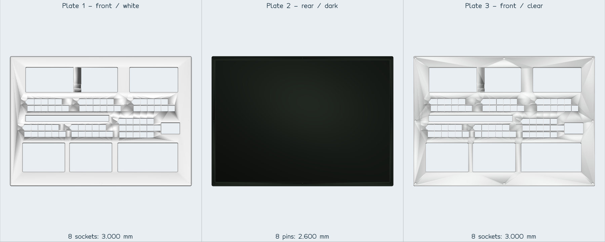 | [`terraforming-mars-tableau-179mm-loch1-zapfen3`](catalog.json#L12) | [`3MF`](models/terraforming-mars-tableau-179mm-loch1-zapfen3.3mf) | User-selected 3.0 mm blind sockets / 2.6 mm pins; full-table fit remains unverified. [Measurements and provenance](docs/terraforming-mars-tableau.md) |
| 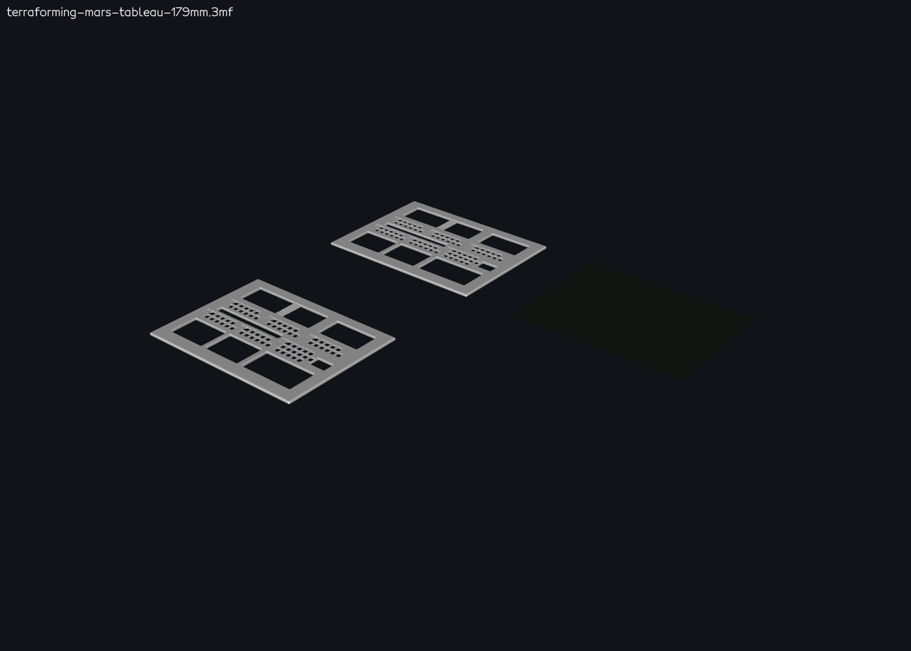 | [`terraforming-mars-tableau-179mm-source`](catalog.json#L34) | [`3MF`](models/terraforming-mars-tableau-179mm.3mf) | Historical 179 mm scaled source revision. [Model notes](docs/terraforming-mars-tableau.md) |
|  | [`terraforming-mars-tableau-fit-samples`](catalog.json#L56) | [`3MF`](models/terraforming-mars-tableau-fit-samples.3mf) | Historical fit coupons for the selected pin/socket pairing. [Fit notes](docs/terraforming-mars-tableau.md) |
| 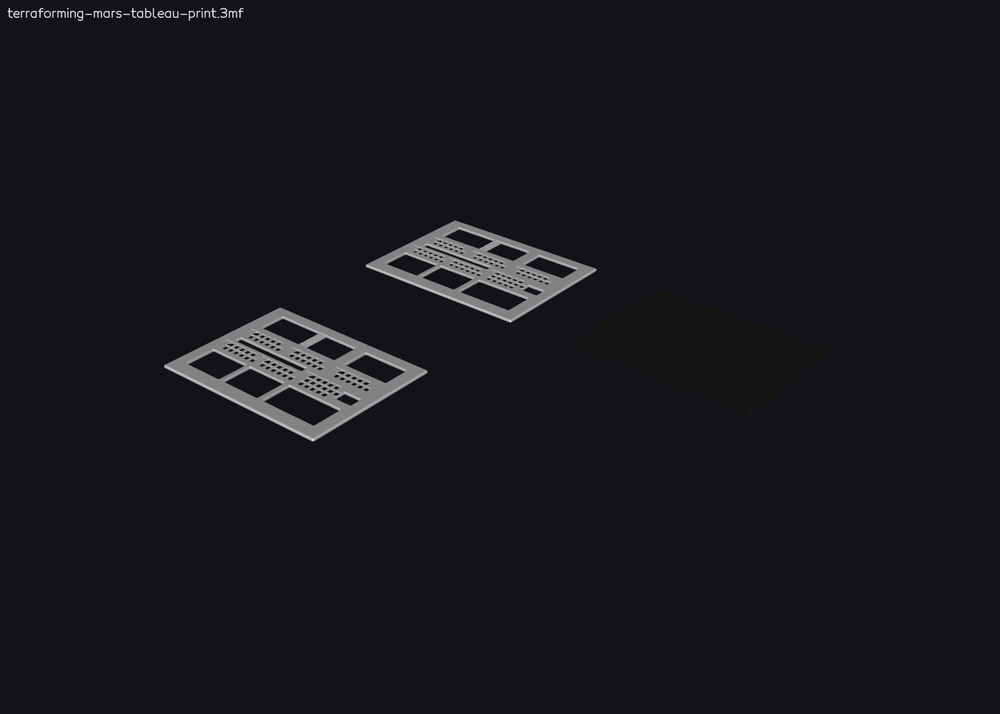 | [`terraforming-mars-tableau-print-source`](catalog.json#L114) | [`3MF`](models/terraforming-mars-tableau-print.3mf) | Preserved original print-project source for comparison. [Model notes](docs/terraforming-mars-tableau.md) |
| 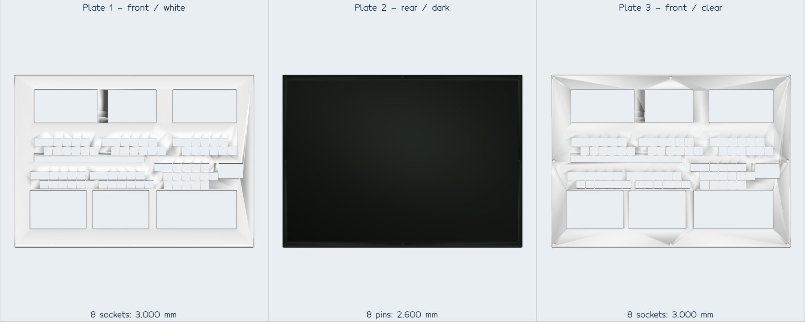 | [`terraforming-mars-tableau-179mm-kurz2mm-raster`](catalog.json#L135) | [`3MF`](models/terraforming-mars-tableau-179mm-kurz2mm-raster.3mf) | Superseded 2 mm raster-shortening revision. [Model notes](docs/terraforming-mars-tableau.md) |
| 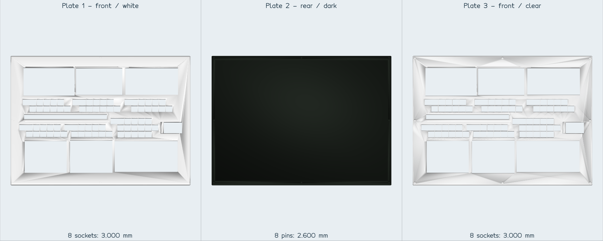 | [`terraforming-mars-tableau-179mm-laminate-aligned`](catalog.json#L159) | [`3MF`](models/terraforming-mars-tableau-179mm-laminate-aligned.3mf) | Superseded laminate-alignment revision. [Model notes](docs/terraforming-mars-tableau.md) |
| 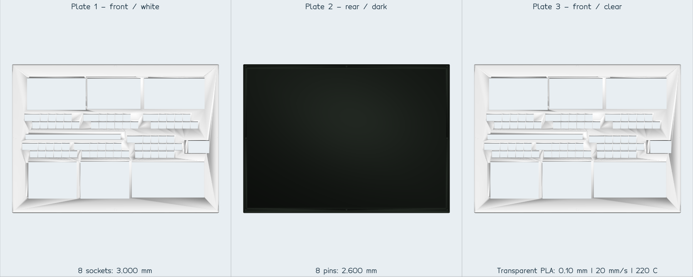 | [`terraforming-mars-tableau-179mm-laminate-slider-cubes`](catalog.json#L183) | [`3MF`](models/terraforming-mars-tableau-179mm-laminate-slider-cubes.3mf) | Superseded slider/cube-position revision. [Model notes](docs/terraforming-mars-tableau.md) |
| 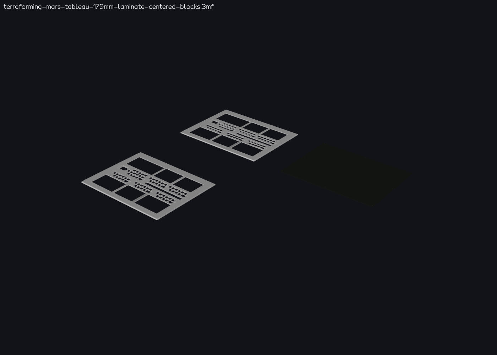 | [`terraforming-mars-tableau-179mm-laminate-centered-blocks`](catalog.json#L199) | [`3MF`](models/terraforming-mars-tableau-179mm-laminate-centered-blocks.3mf) | Current centered-blocks revision; physical laminate fit and print finish remain unverified. [Model notes](docs/terraforming-mars-tableau.md) |
| 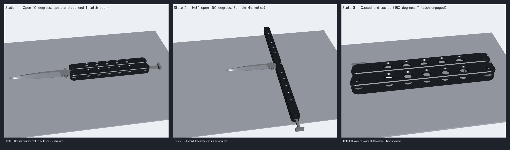 | [`butterfly-messer`](catalog.json#L226) | [`View 3MF`](models/butterfly-messer-view.3mf)<br>[`Print 3MF`](models/butterfly-messer-print.3mf) | Multi-state, two-color balisong assembly. [Dimensions and mechanism](docs/butterfly-messer-masse-und-mechanik.md) · [Print validation](docs/butterfly-messer-druckvalidierung.md) · [Sources and licenses](docs/butterfly-messer-quellen-und-lizenzen.md) |
| 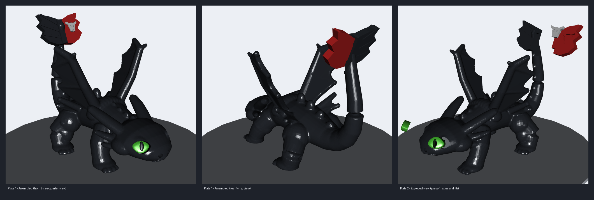 | [`drache`](catalog.json#L241) | [`View 3MF`](models/drache-view.3mf)<br>[`Print 3MF`](models/drache-print.3mf)<br>[All STL outputs](models/) | Multi-part dragon with keyed color parts. [Dimensions](docs/drache-masze.md) · [Assembly and collision checks](docs/drache-montage-und-kollisionspruefung.md) |
| 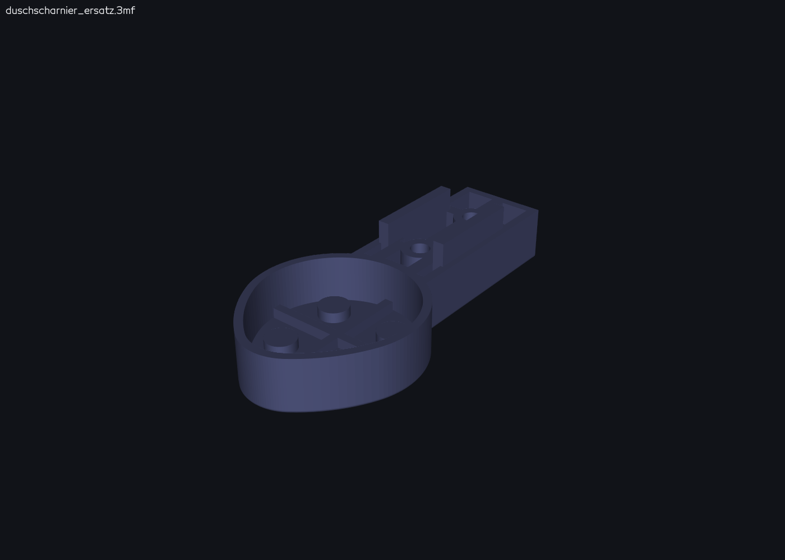 | [`duschscharnier_ersatz`](catalog.json#L261) | [`3MF`](models/duschscharnier_ersatz.3mf)<br>[`STL`](models/duschscharnier_ersatz.stl) | Replacement shower-door hinge body. [Measurements](docs/duschscharnier_ersatz_masse.md) |
| No maintained preview | [`egg-cup-man`](catalog.json#L274) | [`3MF`](models/egg-cup-man-body.3mf)<br>[`STL`](models/egg-cup-man-body.stl) | Egg-cup figure body. [Measurements](docs/egg-cup-man-measurements.md) |
| 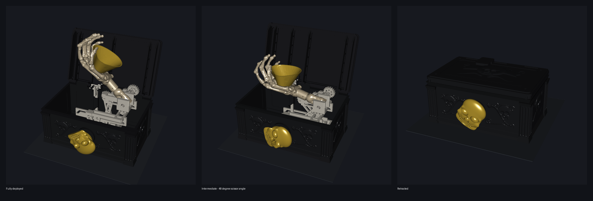 | [`ghouls-grip`](catalog.json#L287) | [`View 3MF`](models/ghouls-grip-view.3mf)<br>[`Print 3MF`](models/ghouls-grip-print.3mf)<br>[Assembly preview STL](models/ghouls-grip-preview.stl) | Multi-state, multi-material mechanical assembly. [Assembly and dimensions](docs/ghouls-grip-masse-und-bauanleitung.md) · [Print validation](docs/ghouls-grip-druckvalidierung.md) · [Source and licenses](docs/ghouls-grip-quellen-und-lizenzen.md) |
| 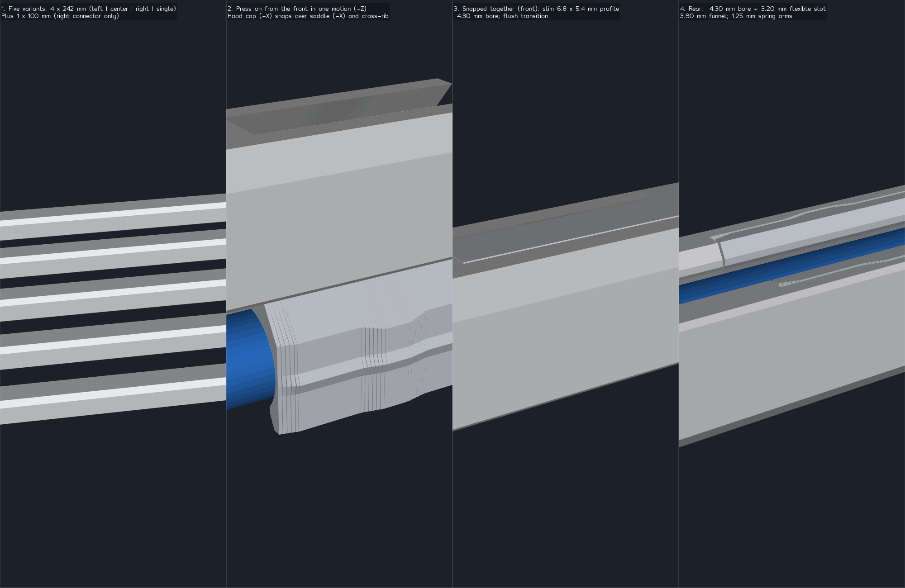 | [`kabelkanal-3-5mm`](catalog.json#L321) | [`View 3MF`](models/kabelkanal-3-5mm-view.3mf)<br>[`Print 3MF`](models/kabelkanal-3-5mm-print.3mf) | Five modular variants for a 3.5 mm cable. [Dimensions](docs/kabelkanal-3-5mm-masstabelle.md) · [Mechanism check](docs/kabelkanal-3-5mm-mechanikpruefung.md) |
| 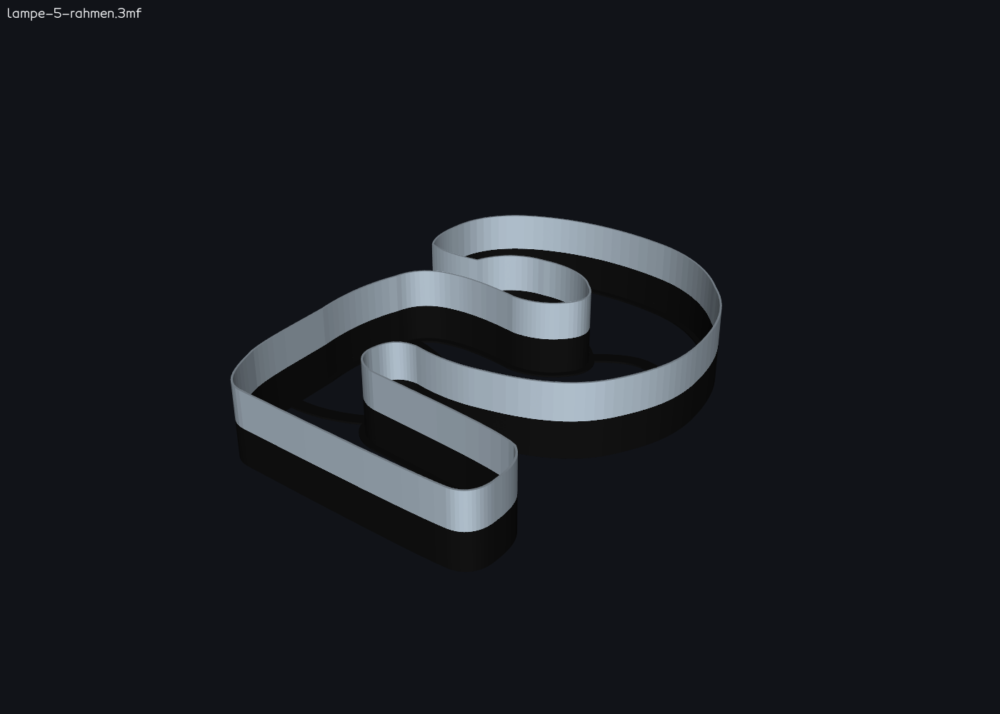 | [`lampe-5`](catalog.json#L339) | [`Frame 3MF`](models/lampe-5-rahmen.3mf)<br>[`Light panels STL`](models/lampe-5-leuchtflaechen.stl) | Frame and four translucent panels for a 240 mm wall lamp. [Dimensions](docs/lampe-5-masse.md) |
| 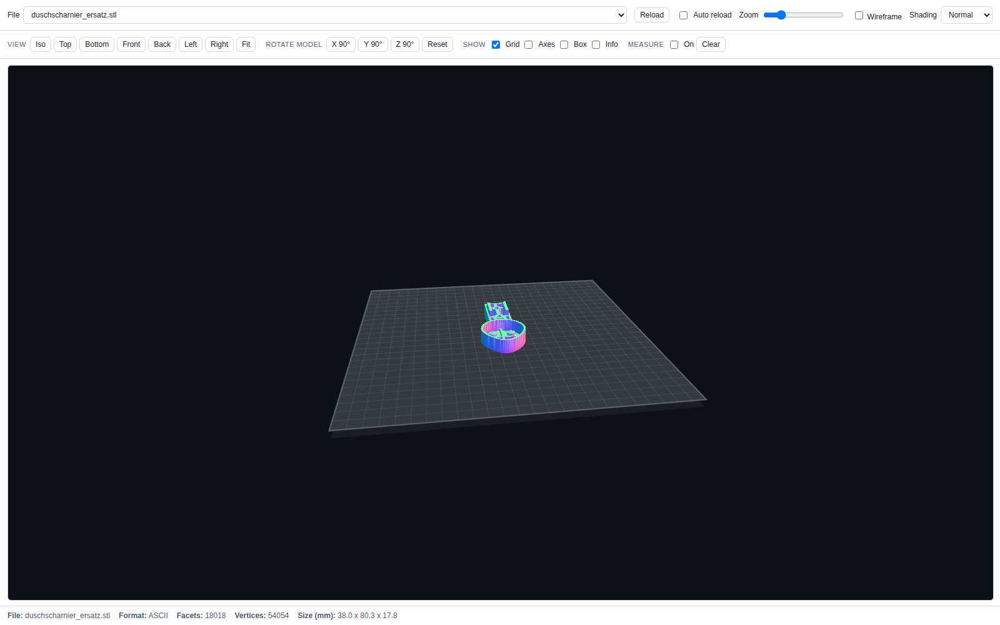 | [`lineal-clip-kappe`](catalog.json#L352) | [`STL`](models/lineal-clip-kappe.stl) | Snap-fit cap for the two holes at the end of a steel ruler. [Photo-to-model example](#example-from-photo-to-printable-stl) |
| 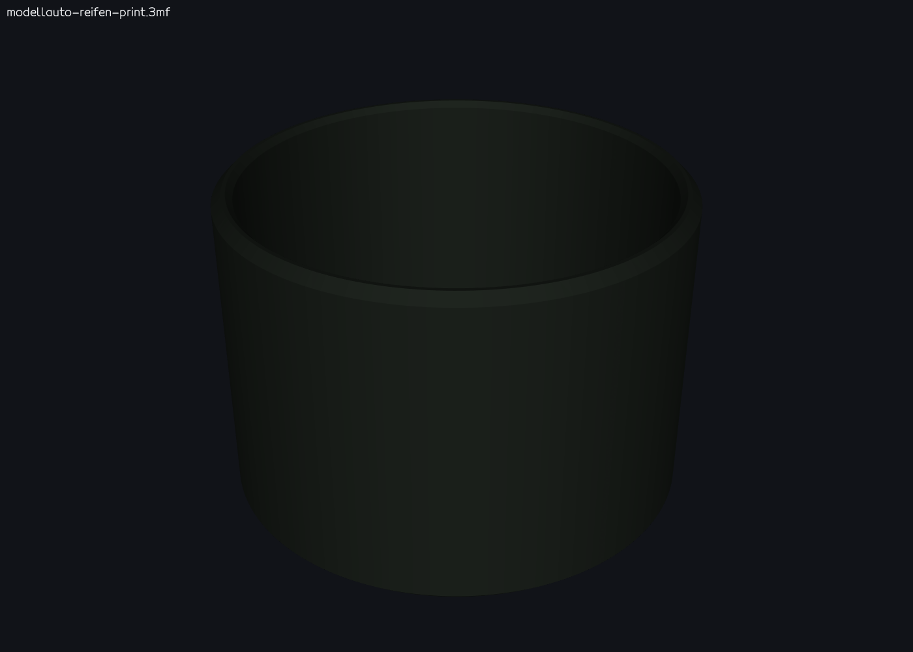 | [`modellauto-reifen`](catalog.json#L362) | [`Print 3MF`](models/modellauto-reifen-print.3mf)<br>[`STL`](models/modellauto-reifen.stl) | PLA replacement tire, 37.2 mm diameter × 26 mm wide. [Measurements](docs/modellauto-reifen-masse.md) |
| No maintained preview | [`pfeffermuehle-mahlwerk-einsatz`](catalog.json#L375) | [`Print-oriented STL`](models/pfeffermuehle-mahlwerk-einsatz-druckorientiert.stl)<br>[`STL`](models/pfeffermuehle-mahlwerk-einsatz.stl) | Pepper-mill mechanism insert. [Measurements](docs/pfeffermuehle-mahlwerk-einsatz-messungen.md) |
| 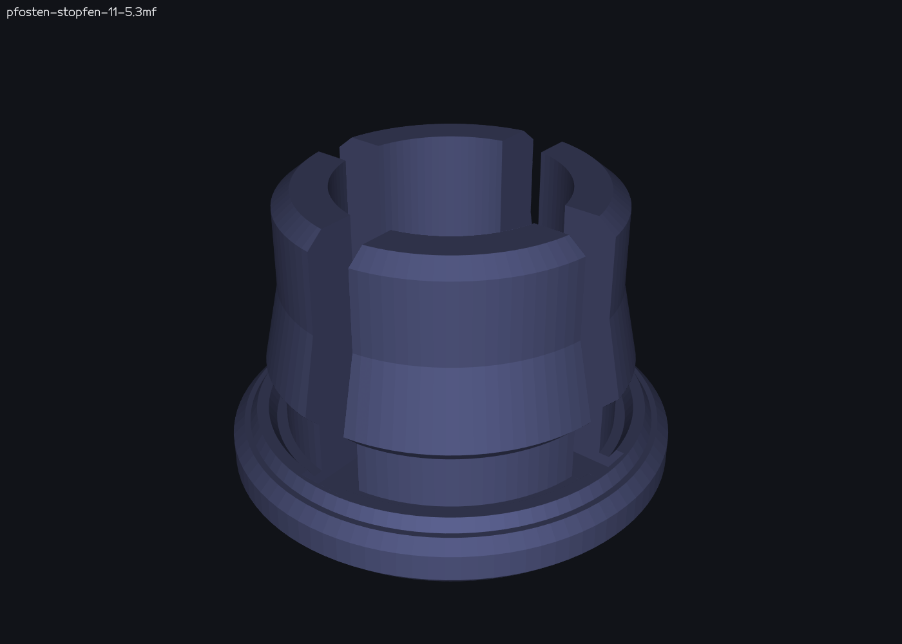 | [`pfosten-stopfen`](catalog.json#L388) | [`3MF`](models/pfosten-stopfen-11-5.3mf)<br>[`STL`](models/pfosten-stopfen-11-5.stl) | 11.5 mm fence-post cap. |
| 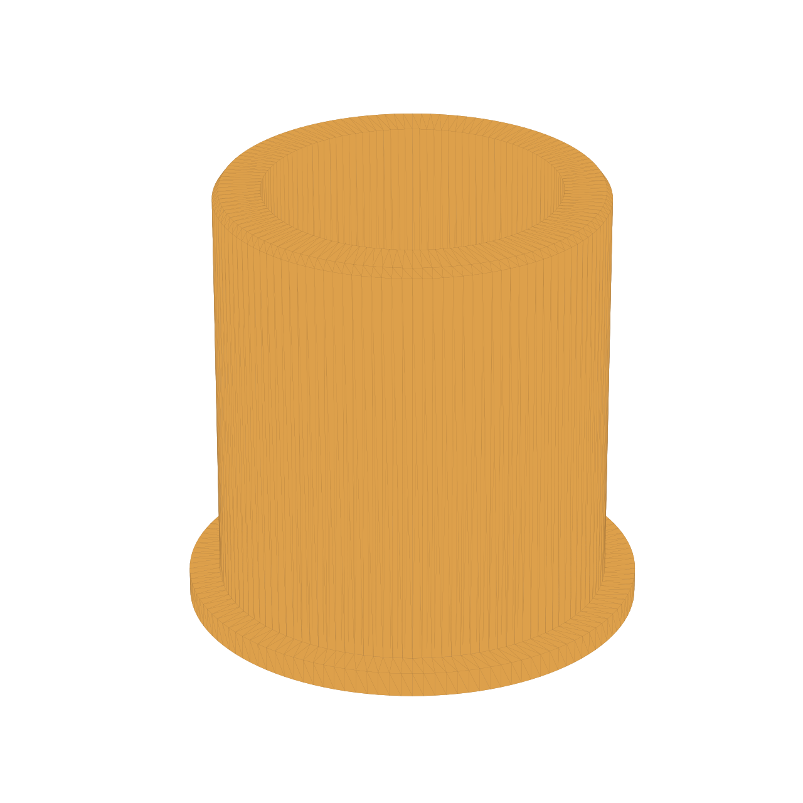 | [`waeschespinne-reduzierring`](catalog.json#L399) | [`STL`](models/waeschespinne-reduzierring-67-50.2.stl) | Reducer ring for a 67.0 mm sleeve bore and 50.2 mm pole. [Measurements](docs/waeschespinne-reduzierring-masse.md) |

The catalog also records each generator, all output paths, and its status.
Historical and source entries are listed for traceability; their presence does
not imply current print validation.

### Token-efficient command evidence

`scripts/compact_output.py` keeps complete command logs while returning bounded
summaries and preserving exit codes. For example:

```powershell
.\.venv\Scripts\python.exe scripts\compact_output.py run --log build\tests.log -- .\.venv\Scripts\python.exe -m unittest discover -s tests
.\.venv\Scripts\python.exe scripts\compact_output.py project models\ghouls-grip-print.3mf
```

Summaries are not a substitute for inspecting omitted warnings or failures. Run
the helper's focused tests with
`.\.venv\Scripts\python.exe -m unittest discover -s tests -p test_compact_output.py`.

New complex projects use one assembled multi-state `-view.3mf` and one
settings-bearing `-print.3mf`. Keep fit-critical dimensions sourced and
documented, regenerate meshes from their scripts, and record print readiness
only after a successful slice with the intended profiles.

## Example: From Photo to Printable STL

This walkthrough shows how the skills in this repo turn a photo plus a couple of
measurements into a validated, printable STL. The example produces
`models/lineal-clip-kappe.stl` — a small cap that clicks into the two holes at the
end of a steel ruler.

### 1. Provide a photo with a scale reference

Place the object on graph paper (or next to a ruler/coin) so the agent can derive a
scale. Here the 5 mm grid **and** the ruler's own cm scale give two independent
references:

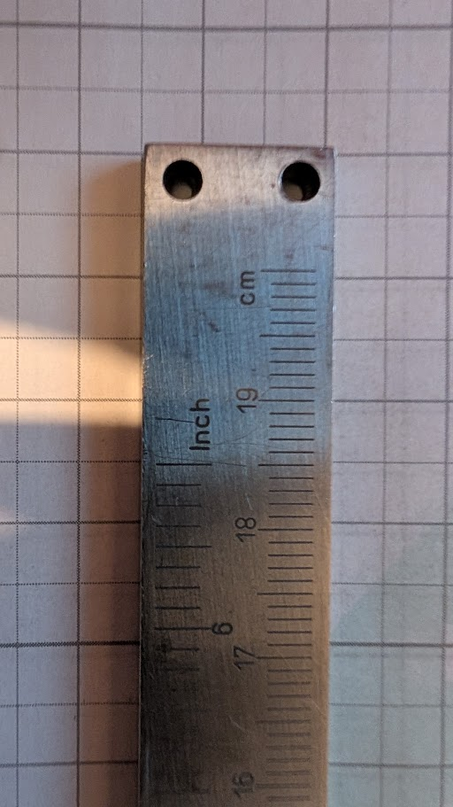

Then describe the intent, e.g.:

> Create an STL file:
> - the object should be a narrow rectangle that sits on top of the two holes
> - it should have two bumps that fit exactly into the holes so it clicks in

### 2. The agent derives measurements from the image

When several reference photos exist, the agent first builds a numbered contact sheet
so it can pick the right photo instead of opening all of them at full resolution:

```powershell
.\.venv\Scripts\python.exe scripts\make_contact_sheet.py model-sources
```

This writes `model-sources/_index.png` plus an index-to-path legend; measurements are
then taken from the full-resolution tiles that actually show the feature.

Once a model is finished, the raw reference photos are deleted and only the contact
sheet is kept, renamed after the model, under `model-sources/archiv/`
(see `model-sources/archiv/README.md` for the tile-to-file legend).

The `stl-from-image-measurements` skill scales the image and reports what is measured
versus inferred:

| Dimension | Value | Source |
|-----------|-------|--------|
| Ruler width | 14.5 mm | image scaling (5 mm grid ≈ 14.4 px/mm) |
| Hole diameter | 2.5 mm | image scaling |
| Hole spacing (centre-to-centre) | 9.1 mm | image scaling |
| Hole centre from top edge | 3.2 mm | image scaling |
| Material thickness | 2.0 mm | **user supplied** (not visible from a top view) |

### 3. Confirm the fit-critical values

Anything that controls a fit is confirmed before geometry is built. In this run the
agent asked three targeted questions:

1. Are the estimated hole diameter / spacing / width correct? → *accept estimates*
2. How thick is the ruler? → *2.0 mm*
3. How should the bumps engage? → *snap hooks with a retaining lip (audible click)*

### 4. Geometry is generated as a parametric script

`scripts/lineal_clip_kappe.py` builds the solid with `trimesh` + `manifold3d` booleans,
so every dimension stays editable:

- Plate: 14.5 × 7.0 × 2.0 mm
- Peg shaft ⌀2.30 mm = 2.5 mm hole − 0.20 mm press-fit clearance
- Shaft length 2.0 mm (= material thickness), then a ⌀3.00 mm barb with a 0.35 mm retaining ledge
- 1.4 mm lead-in cone (≈34°) for easy insertion
- 0.6 mm compliance slot per peg → two 0.85 mm spring legs so it actually snaps

### 5. Validate and preview

The `validate-stl-mesh` checks must all pass before the file is considered done:

```
facets: 972
extents: [14.5, 7.0, 5.4]
watertight: True
winding_consistent: True
euler: 2
degenerate: 0
volume_mm3: 217.761
```

The result is then opened in the new STL Canvas SPA (GitHub Pages), which uses
the same renderer as the GitHub Copilot App canvas extension — shown here with
the **Normal** shader and fully zoomed to the model:


### 6. Print orientation

The model is exported in its print orientation: plate flat on the bed, snap pegs
pointing up (+Z). No supports are needed — the only overhang is the 0.35 mm retaining
ledge. In use the part is flipped and pressed onto the ruler.

### 7. Iterate

If the fit is too tight or too loose, adjust `HOLE_DIA` / `PRESS_CLEAR` in
`scripts/lineal_clip_kappe.py` and re-run the script instead of editing the mesh.

## Contributor guidance

The detailed modeling, fit, licensing, language, and validation rules are
maintained in [`AGENTS.md`](AGENTS.md). Task-specific procedures are indexed in
[`.github/skills/README.md`](.github/skills/README.md).

## Blender and OrcaSlicer workflow

Technical features, dimensions, fits, joints and clearances remain parametric in
Python. Organic or visually complex regions may be authored or refined in Blender.
Use Blender CLI for deterministic scene builds, batch import/export and renders,
and the official local Blender Lab MCP for bounded interactive inspection and
visual edits. The two paths may be combined, but Blender exports are always treated
as external meshes and must pass the same scale, topology, feature and render
checks as any downloaded model.

Every new complex assembly is delivered as `models/<name>-view.3mf` plus one
`models/<name>-print.3mf`. The view file contains the assembled object, with
meaningful mechanism states on additional plates; the single print project
contains all material/spool mappings and print plates, grouping same-color parts
when safe. OrcaSlicer is the final print gate: each print plate is sliced with
the intended Kobra S1, nozzle, process and filament profiles, and the resulting
print time, material estimate, supports and warnings are documented. When colors
can be separated without unacceptable loss of appearance or strength, keyed
separately printed bodies are preferred over purge-heavy in-place multicolor
printing.

The project MCP template is `.vscode/mcp.json`. Blender uses the official Blender
Lab MCP server through a local `uv` installation. OrcaSlicer is configured as an
opt-in, disabled-by-default template because the official OrcaSlicer integration is
its CLI rather than a first-party MCP server. See
[`docs/mcp-setup.md`](docs/mcp-setup.md) before enabling either integration.

## Local 3D generation models (optional)

For organic regions without a usable licensed asset, agents ask whether local
image-to-3D models should create a seed mesh. The default install uses ComfyUI
with the MIT-licensed TRELLIS.2/Pixal3D models and official Comfy-Org templates,
in a user-local folder outside this repository. If declined or the hardware is
unsuitable, work continues with Gemini-assisted image analysis and Blender or
build123d code. Generated meshes are seeds only; fit-critical geometry remains
parametric.

```powershell
.\.venv\Scripts\python.exe scripts\genai_hw_probe.py              # tier recommendation
.\.venv\Scripts\python.exe scripts\genai_local_setup.py           # dry-run install plan
.\.venv\Scripts\python.exe scripts\genai_local_setup.py --yes     # install
.\.venv\Scripts\python.exe scripts\genai_comfy_run.py --workflow <api.json> --image <ref.png> --seed 42 --out build\genai\run1
.\.venv\Scripts\python.exe scripts\genai_mesh_postprocess.py build\genai\run1\<mesh>.glb build\genai\seed.stl --height 80
```

Hardware tiers, licenses and the learnings adopted from 3DGenStudio are in
[`docs/local-3d-genai-setup.md`](docs/local-3d-genai-setup.md).

## Mesh CLI

`scripts/mesh_tool.py` is the shared command-line companion for the skills above.
It uses `trimesh` + `manifold3d`, always writes ASCII STL, and knows the 250 × 250 mm
bed and both coordinate conventions.

```powershell
.\.venv\Scripts\python.exe scripts\mesh_tool.py info     models\lineal-clip-kappe.stl
.\.venv\Scripts\python.exe scripts\mesh_tool.py validate models\lineal-clip-kappe.stl
.\.venv\Scripts\python.exe scripts\mesh_tool.py overhang models\lineal-clip-kappe.stl
.\.venv\Scripts\python.exe scripts\mesh_tool.py measure  models\lineal-clip-kappe.stl --infill 20
```

| Command | Purpose |
|---------|---------|
| `info` / `validate` | mesh stats, watertightness, Euler number, degenerate faces, bed placement |
| `repair` | lossless repair recipe for OCCT/build123d exports (no `pymeshfix`) |
| `measure` | bounding box, volume, mass and filament length estimate |
| `center` / `transform` | bed centering per convention, scale/rotate/translate/fit |
| `boolean` | union/difference/intersection via the manifold engine |
| `probe` / `slices` | prove a feature exists (volume probe, cross-section sweep) |
| `overhang` | unsupported area for the current print orientation |
| `arrange` | lay several parts out on the build plate |
| `compare` | compare the same model across worktrees before trusting a bug report |

## Web app: "3d-printing model viewer"

The GitHub Pages SPA is a lightweight STL/3MF viewer for files in `models/`.
It uses the same browser renderer as the Copilot Canvas extension, so previews
are consistent between the web and agent UI.

### Features

- 3D previews of **STL and 3MF** files in `models/`
- Multi-plate 3MF files open in **All plates** mode by default, showing every
  plate, project totals, and the number of plates. Build/component transforms and
  OrcaSlicer `plater_id` values are preserved. In the overview, projects with
  more than two plates use a spaced grid; two plates are arranged side by side.
  Individual plates remain selectable. Reloading the same file preserves the
  selection, while changing files resets it to **All plates**.
- Material colors from OrcaSlicer's filament palette and object/part assignments;
  standard 3MF material colors remain the fallback for other 3MF files.
- A compact, always-visible print summary for time, total material, support
  material, filament length, and validation status for **all plates**, even when
  an individual plate is selected.
- A collapsible details overlay in the lower-right corner with profile, color,
  bed, walls, infill, support type, plate count, and complete project metadata,
  plus a separately expandable **Print data by plate** table with print time,
  material, support material, filament length, and status for each plate.
- A single collapsible menu for reload/auto-reload, zoom, shading, wireframe,
  views, model rotation, overlays, and measurement tools.
- A local Canvas **Open 3MF** button that opens the currently selected workspace
  3MF in the default application registered for `.3mf`, using the validated
  local launcher.
- Direct download of the currently selected file.
- A link back to the repository on GitHub.
- A button to create a model request using
  `.github/ISSUE_TEMPLATE/model-request.yml`

The web SPA and Copilot Canvas extension share the renderer and layout. The
OrcaSlicer launcher is available only in the local extension; the public website
cannot launch a local desktop application.

On mobile devices, the page uses a lower canvas pixel ratio and disables the
previous automatic polling so large models load and render noticeably faster.

### Request a New Model

For new parts or fit-critical changes, open an issue using the
`.github/ISSUE_TEMPLATE/model-request.yml` template and attach photos,
measurements in mm, material/color notes, and the definition of done.

### PR Output for Model Work

PRs resulting from these model issues should use
`.github/pull_request_template.md`. The template requests:

- Exact paths of changed scripts, models, and documents
- Validation commands and mesh results
- Rendered previews or slicer previews for the final STL/3MF
- Identification of estimates and remaining test-print risks

## Coordinate Convention

Models support both placement conventions on the 250 × 250 mm bed:

- **Center-origin** — XY target `(0, 0)`
- **Corner-origin** — XY target `(125, 125)`

Convention is auto-detected from coordinates: negative XY implies center-origin, otherwise corner-origin. When ambiguous, corner-origin is used to match common slicer build-plate coordinates.

## Third-party geometry and attribution

The skeleton hand of the Ghoul's Grip is derived from
**"Wrist Bones Full Hand - Human Skeleton"**, NIH 3D Print Exchange model
`3DPX-016815` by *My Segmenter* (mysegmenter.com), licensed **CC BY**.

Only the derived, classified and decimated bone set
`model-sources/ghouls-grip/reference/hand_bones.npz` is committed;
`scripts/extract_hand_bones.py` re-downloads the 12 MB source STL on demand.
Redistributing the Ghoul's Grip models must keep this attribution.
