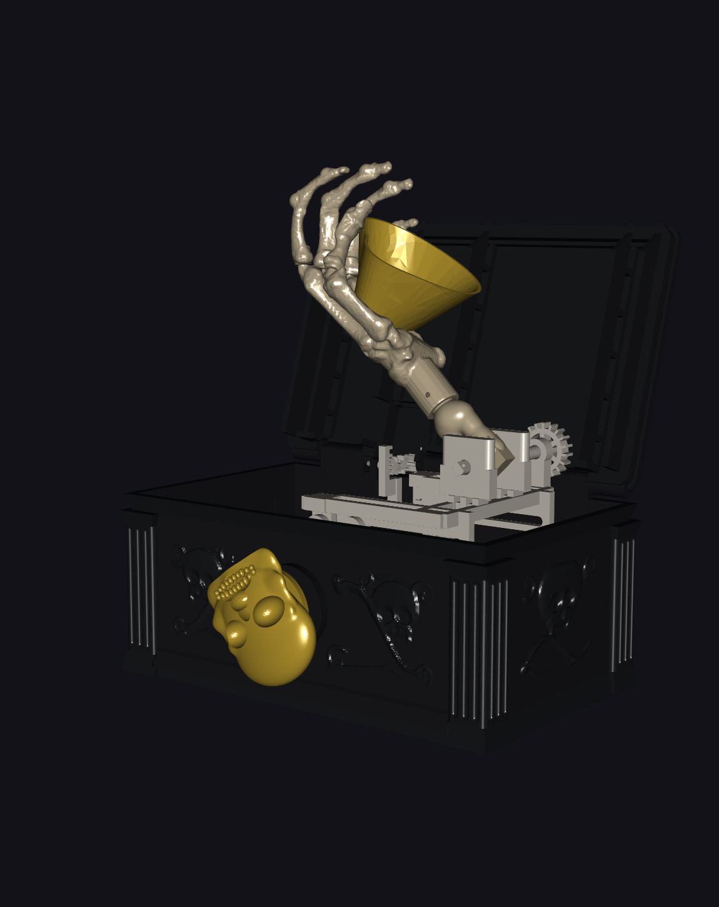
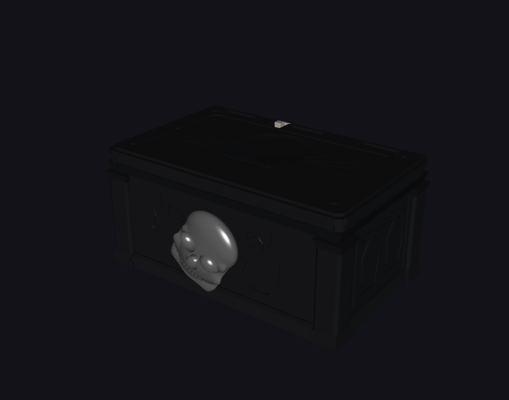

# Ghoul’s Grip – Bauanleitung

Diese Anleitung führt durch den Zusammenbau der vorhandenen **42 Druckteile**
aus `models/ghouls-grip-print.3mf`. Die goldene Süßigkeitenschale ist optional;
ohne sie werden 41 Druckteile montiert. Zusätzlich werden sechs Stücke
PLA-Filament mit Ø1,75 mm als Achse bzw. Querstifte benötigt.

**Stand:** digital geprüfter Funktionsprototyp, kein physisch erprobter Bausatz.
Passung, Axialsicherung und belasteter Dauerbetrieb müssen am tatsächlichen
Druck geprüft werden. Es werden weder Federn noch Gummibänder, Seile oder
Klebstoff für die beweglichen Verbindungen benötigt.

## 1. Übersicht und Orientierung

[Explosionszeichnung in voller Auflösung öffnen](images/ghouls-grip-explosionszeichnung.png).
Die Bildnummern 1–8 bezeichnen **Baugruppen**, nicht die untenstehenden
Arbeitsschritte. Die gestrichelten Pfeile sind Darstellungsachsen, keine
Einführpfade. Besonders Hubjoch und Deckel benötigen die beschriebenen Versätze.
Die Filamentstifte sind im Bild nicht dargestellt.

Stelle die Truhe mit der Öffnung nach oben und der Totenkopf-Bohrung zu dir.
„Vorn“ ist die Knaufseite (−Y), „hinten“ die Scharnierseite (+Y).
Von dieser Vorderseite aus gesehen zeigt +X nach rechts, −X nach links;
+Z zeigt nach oben. Das Scharnier läuft quer von links nach rechts.
Die Bezeichnungen bleiben auch beim Umdrehen des Deckels auf die Truhe bezogen.

## 2. Teile und Arbeitsplatz vorbereiten

Lege die Teile auf einer weichen Unterlage aus. Hilfreich sind Seitenschneider,
eine kleine Zange, Pinzette, Messschieber und feine Entgratwerkzeuge.
Schneide Filament und entferne Stützmaterial mit Abstand zu Fingern und Augen;
beim Prüfen nicht in Scheren, Zahnräder oder Scharniere greifen.

| Baugruppe im Bild | Teile bereitstellen |
| --- | --- |
| 1 – Gehäuse | 1 schwarze Truhe |
| 2 – Schlitten | 1 naturweißer Schlitten mit Zahnstange und Kurvenbahn |
| 3 – Hauptantrieb | 1 Ritzel mit D-Welle, 1 goldener Totenkopfknauf |
| 4 – Deckelantrieb | 1 Folger-Zahnstange, 2 Transferzahnräder mit Zapfen, 1 Folger-Pressstift |
| 5 – Schere | 4 Arme, 1 Scheren-Eingangszahnrad; passende Gelenkstifte |
| 6 – Hubjoch | 1 Plattform, 3 Zwischenräder, 1 Abtriebsrad mit D-Welle; passende Gelenkstifte |
| 7 – Arm und Hand | 1 Unterarm, 1 Handfläche, 5 unterschiedliche Finger; optional 1 goldene Schale |
| 8 – Deckel | 1 schwarzer Deckel, 1 Deckelkurbel, 1 Kurbel-Distanzhülse |

Entferne Stützen und lose Grate besonders aus Zahnlücken, Schlittenführungen,
Schnappschlitzen, D-Aufnahmen und Querbohrungen. An den Knochenübergängen keine
Kerben einsägen: Die Fingergelenke sind absichtlich **massiv und unbeweglich**.
Passflächen nicht pauschal aufbohren oder abschleifen. Klemmt eine Verbindung,
zuerst Stützreste, Orientierung und passende Stiftvariante prüfen.

### Filamentstifte zuschneiden

Verwende gerades PLA-Filament Ø1,75 mm und entgrate die Schnittenden.
Die Längen sind dem bestehenden Maßvertrag entnommen.

| Anzahl | Länge je Stück | Verwendung |
| ---: | ---: | --- |
| 1 | 198 mm | Deckelscharnier, durch Truhe, Deckel, Kurbel und Distanzhülse |
| 1 | 14 mm | Knauf und Hauptantriebswelle quer sichern |
| 2 | 5 mm | Zapfen der beiden Deckel-Transferzahnräder quer sichern |
| 1 | 10 mm | Unterarm-Abtriebswelle außen quer sichern |
| 1 | 16 mm | Handgelenk quer sichern |

### Gedruckte Stifte sortieren

Die 13 Schnappstifte sind nicht austauschbar. Zusammen mit dem massiven
Folger-Pressstift sind es 14 gedruckte Stifte. Sortiere die Schnappstifte nach
Klemmlänge, nicht nur nach Gesamtlänge; der Folger-Pressstift hat keine Rastschlitze.

| Funktion / Kennung im Projekt | Anzahl | Klemmlänge | Einbauort |
| --- | ---: | ---: | --- |
| `pivot-pin-floor` | 2 | 18,4 mm | Bodenlager der beiden Scherenebenen |
| `pivot-pin-slider` | 2 | 11,2 mm | untere bewegliche Armenden am Schlitten |
| `pivot-pin-centre` | 2 | 8,4 mm | Kreuzung der beiden Arme je Ebene |
| `pivot-pin-gear` | 1 | 16,4 mm | oberer Festpunkt auf der Seite des Eingangszahnrads |
| `pivot-pin-short` | 3 | 6,8 mm | gegenüberliegender oberer Festpunkt und beide oberen Langlochpunkte |
| `pivot-pin-idler` | 3 | 11,4 mm | die drei Zwischenräder am Hubjoch |
| `pivot-pin-follower` | 1 | Pressstift | Folger in der Kurvenbahn |

Schnappstifte von der Kopfseite durch die fluchtenden Bohrungen einschieben,
bis die Rastnase hinter der Gegenfläche liegt. Nicht mit einem Hammer
einschlagen. Der Kopf darf das Gelenk nicht festklemmen.

## 3. Schlitten und Hauptantrieb montieren

**Bildgruppen 1–3 · ursprüngliche Montageschritte 1–4**

Setze den Schlitten senkrecht auf die Bodenführungen. Drücke nur an stabilen
Rahmenbereichen, bis beide integrierten Schnappfinger in die Nut greifen.
Bewege ihn vorsichtig von Hand durch seinen Weg: Er soll geführt bleiben,
aber ohne Verkanten gleiten.

Führe das Hauptantriebsritzel **von innen** axial durch die Bohrung in der
Vorderwand. Die Zähne müssen in die Schlittenzahnstange greifen.
Bringe den Schlitten in die geschlossene Ausgangsstellung, ohne ihn gewaltsam
gegen einen Anschlag zu drücken. Stecke außen den Totenkopf mit senkrechtem
Gesicht auf die D-Welle; sichere die fluchtenden Querbohrungen mit dem
**14-mm-Filamentstift**.

**Zwischenprüfung:** Eine kleine Knaufdrehung bewegt den Schlitten, ohne dass
die Zähne überspringen. Der Knauf ist ein Drehantrieb, kein Druckknopf.

## 4. Deckel-Folger und Transferzahnräder einsetzen

**Bildgruppe 4 · ursprüngliche Montageschritte 5–6**

Senke die Folger-Zahnstange in ihren Führungskanal. Drücke den massiven
Folger-Pressstift von innen durch den Folger in den Kurvenschlitz des Schlittens.
Die Rippen dieses Stifts bilden den vorgesehenen Presssitz.

Schiebe beide Transferzahnräder axial in **−X** in ihre Lagerböcke, bis ihr
Bund innen anliegt. Sichere jeden außenliegenden Zapfen quer mit einem
**5-mm-Filamentstift**. Die beiden Räder übertragen die Bewegung weiter zur
später montierten Deckelkurbel.

**Zwischenprüfung:** Beim vorsichtigen Verschieben des Schlittens steigt der
Folger zunächst an und bleibt anschließend auf dem oberen Abschnitt der
Kurvenbahn. Er darf weder aus der Führung springen noch verkanten.

## 5. Beide Scherenebenen aufbauen

**Bildgruppe 5 · ursprünglicher Montageschritt 7**

Ordne je zwei Arme als gekreuztes Paar an den beiden seitlichen Scherenebenen
an. Die Arme verbinden unten je einen festen Bodenpunkt und einen beweglichen
Schlittenpunkt; oben folgen ein Festpunkt und ein Langlochpunkt am Hubjoch.
Die Bohrungssenkungen zeigen jeweils nach außen.

Beginne in der flachen Scherenstellung (**18°**). Setze zuerst die beiden
Bodenstifte ein, solange der mittlere Raum noch gut zugänglich ist:
**vom Kisteninneren nach außen**, niemals durch die geschlossene Außenwand.
Verbinde anschließend die unteren Schlittenpunkte und die mittleren
Kreuzungen mit den jeweils zugeordneten Stiften. Die oberen Verbindungen
bleiben bis zum Einsetzen des Hubjochs frei.

**Zwischenprüfung:** Beide Paare müssen gemeinsam und ohne seitliches
Verziehen beweglich sein. Lose Teile dabei abstützen. Sind Bohrungen nicht
fluchtend, nicht mit dem Stift in Position hebeln.

## 6. Scheren-Eingangszahnrad vor dem Hubjoch setzen

**Bildgruppe 5 · ursprünglicher Montageschritt 8**

Bringe die abgestützte Schere für diesen Eingriff in die **48°-Stellung**.
Schiebe das Eingangszahnrad von **+Y** auf das obere Armauge, richte seinen
Passstift zum Armloch aus und setze es in Lage. Dieses Zahnrad muss **vor**
der Plattform eingesetzt werden; danach ist der Einführraum eingeschränkt.
Die endgültige obere Gelenksicherung erfolgt beim Einbau des Hubjochs.

**Zwischenprüfung:** Der Passstift sitzt im vorgesehenen Armloch.
Das Zahnrad darf nicht nur lose auf der Armfläche aufliegen.

## 7. Hubjoch und Unterarm außerhalb vormontieren

**Bildgruppen 6–7 · ursprünglicher Montageschritt 9**

Lege die Plattform außerhalb der Truhe bereit. Setze den Unterarm zwischen
die Lagerohren. Führe die D-Welle des Unterarm-Abtriebsrads axial durch die
Lager und die passende Unterarm-D-Aufnahme. Sichere die Welle außen mit dem
**10-mm-Filamentstift**.

Setze die drei Zwischenräder an ihre Lagerstellen und sichere sie mit den
drei zugehörigen Zwischenrad-Schnappstiften. Zusammen mit Scheren-Eingangsrad
und Unterarm-Abtriebsrad entsteht die Fünf-Zahnrad-Kette.

**Zwischenprüfung:** Die drei Zwischenräder und das Abtriebsrad stehen in
einer gemeinsamen Eingriffsebene. Die Welle ist gesichert, der Unterarm
kann sich mit dem Abtriebsrad bewegen.

## 8. Hubjoch in die Schere einsetzen

**Bildgruppe 6 · Fortsetzung des ursprünglichen Montageschritts 9**

Bringe die abgestützte Schere in die ausgefahrene Stellung (**78°**).
Halte die vormontierte Plattform zunächst **3 mm vom
Scheren-Eingangszahnrad weg**, in Richtung des ersten Zwischenrads, versetzt.
Senke sie in dieser versetzten Lage ab. Schiebe sie erst danach entlang der
Verbindungslinie der Zahnradachsen in den Eingriff.

**Nicht einfach senkrecht in die Verzahnung drücken:** Die Achsverbindung
liegt 64° zur Senkrechten; gerades Absenken würde Zahn auf Zahn treffen.
Schließe nach dem Ausrichten die oberen Fest- und Langlochverbindungen:
ein langer Zahnradstift auf der Eingangszahnradseite und drei kurze Stifte
an den übrigen oberen Punkten.

**Zwischenprüfung:** Beide Scheren tragen das Joch. Die oberen beweglichen
Punkte laufen in ihren Langlöchern; die fünf Zahnräder greifen ineinander.
Bei Widerstand wieder aus dem Eingriff nehmen und die Zahnstellung prüfen.

## 9. Handfläche, Finger und optionale Schale montieren

**Bildgruppe 7 · ursprünglicher Montageschritt 10**

Lass die Mechanik ausgefahren und abgestützt. Richte die Handfläche wie im
Ansichtsprojekt aus: gegenüber dem Unterarm-Bezug um **−75° gerollt**.
Schiebe die Aufnahme auf den Unterarmzapfen, bis die Querbohrungen fluchten,
und setze den **16-mm-Filamentstift** quer ein.

Stecke die Finger einzeln auf ihre jeweils passenden angewinkelten
MCP-Zapfen. Reihenfolge: **Zeigefinger → Mittelfinger → Ringfinger →
kleiner Finger → Daumen**. Führe jede Aufnahme vom freien Zapfenende entlang
seiner Achse zum Handteller. Nicht senkrecht über alle Zapfen drücken und
nicht an den Fingergelenken biegen. Die Steckkrägen schließen bündig an
die freigestellten Mittelhandköpfchen an.

Optional: Richte die drei asymmetrisch angeordneten Unterseitenstifte der
goldenen Schale zu den drei bündigen Sacklöchern der Handfläche aus.
Stecke die Schale von oben entlang ihrer Öffnungsnormalen ein, ohne
Finger oder Knochen als Hebel zu benutzen.

**Zwischenprüfung:** Handgelenk quer gesichert, alle fünf Finger korrekt
zugeordnet, Schale ohne Spannung eingesetzt. Finger und Schale sind
lösbare Steckteile, **nicht verriegelt**; beim Kippen oder Zerlegen festhalten.

## 10. Deckelkurbel und Distanzhülse am losen Deckel vormontieren

**Bildgruppe 8 · ursprünglicher Montageschritt 11**

Lege den Deckel umgedreht auf eine weiche Unterlage. Führe die Deckelkurbel
von unten ein und schiebe sie **5,6 mm in +X** in ihre Mitnehmertasche.
Lege die Distanzhülse von unten in den Servicekanal zwischen Kurbel und
Deckelauge. Halte die losen Teile beim Wenden in Position.

**Wichtig:** Erst danach den Deckel an die Truhe setzen. Bei montiertem Deckel
ist der Servicekanal geschlossen und die Kurbel nicht mehr von unten einsetzbar.

**Zwischenprüfung:** Kurbelmitnehmer sitzt in der Tasche; Kurbel, Hülse und
Scharnieraugen liegen auf derselben Achse.

## 11. Deckel ansetzen und Scharnierachse einführen

**Bildgruppe 8 · ursprünglicher Montageschritt 12**

Bringe die Mechanik vorsichtig in die **48°-Scherenstellung**; der Deckelantrieb
befindet sich dabei im geöffneten Zustand. Halte die Deckelbaugruppe etwa
**108° geöffnet** und zunächst **3 mm nach hinten (+Y)** versetzt.
Senke sie ab und schiebe sie dann nach vorn in den Eingriff mit dem
Transfer-Zwischenrad, bis die Gelenkaugen fluchten.

Schiebe das **198-mm-Scharnierfilament von der Stirnseite** durch Truhe,
Deckel, Kurbel und Distanzhülse. Stütze den Deckel währenddessen ab.
Bei Widerstand die Augen ausrichten, nicht mit dem langen Filamentstift
die Baugruppen zusammenzwingen. Die Hülse hält die Kurbel axial im Eingriff.

**Zwischenprüfung:** Achse vollständig eingeführt, Distanzhülse vorhanden,
Deckelkurbel mit dem Deckel verbunden. Der Deckel wird vom Getriebe geführt;
nicht unabhängig gegen den Antrieb zu- oder aufklappen.

## 12. Trockenlauf und Abnahme

Teste zunächst **ohne Süßigkeiten und ohne Last**. Drehe ausschließlich den
Totenkopf langsam über den vorgesehenen Weg von ungefähr 114° und danach
genau zurück. Nicht über die Endlagen drehen.

- [ ] Der Deckel öffnet früh und bleibt frei vom Bewegungsraum der Hand.
- [ ] Beide Scheren heben gleichmäßig; kein Arm streift an der Truhenwand.
- [ ] Der Unterarm entfaltet sich mit dem Hub und faltet sich beim Rücklauf ein.
- [ ] Die Hand samt optionaler Schale passt eingefahren vollständig hinein.
- [ ] Kein Zahn überspringt, kein Stift wandert heraus, kein Schnappgelenk klemmt.
- [ ] Der Deckel schließt ohne Druck von Hand; lose Finger und Schale bleiben sicher sitzen.

**Bei Knacken, starkem Widerstand oder Zahnüberspringen sofort stoppen.**
Entlaste die Mechanik und behebe die Ursache, statt mehr Kraft am Knauf
aufzubringen. Eine bestandene digitale Prüfung ersetzt diese Kontrolle am
gedruckten Exemplar nicht. Keine bestätigte Nutzlast oder PLA-Dauerfestigkeit;
nicht unbeaufsichtigt belasten.

Für Süßigkeiten nur verpackte Ware oder einen lebensmittelechten Einsatz
verwenden. Ungeschütztes FDM-PLA ist nicht als lebensmittelecht zertifiziert.
Nicht über die im geschlossenen Zustand verbleibende freie Höhe füllen.

## 13. Typische Montageprobleme und Demontage

| Problem | Zuerst prüfen |
| --- | --- |
| Schlitten klemmt | Stützreste in der Führung, beide Schnappfinger korrekt in der Nut, Rahmen nicht verkantet |
| Schnappstift rastet nicht ein | passende Klemmlänge, fluchtende Bohrungen, freie Schlitzhälften; keinen kürzeren Stift erzwingen |
| Hubjoch lässt sich nicht einsetzen | 78°-Stellung, Eingangszahnrad bereits gesetzt, 3-mm-Versatz vor dem Eingriff |
| Deckelkurbel lässt sich nicht montieren | Deckel wieder abnehmen; Kurbel und Hülse müssen am losen Deckel vormontiert werden |
| Deckelantrieb springt über | Transferzahnräder gesichert, Kurbelmitnehmer in Tasche, Distanzhülse eingesetzt |
| Hand oder Finger passen nicht | passende D-/Zapfenausrichtung, Fingerzuordnung und freie Stützreste; Knochen nicht aufbiegen |
| Stift wandert axial | Betrieb stoppen und Sicherung kontrollieren; besonders bei älteren gedruckten Bodenpins |

Vor dem Zerlegen die Mechanik entlasten und Deckel sowie Hand abstützen.
Schale abheben, Filamentstifte herausziehen und in umgekehrter Reihenfolge
zerlegen. Schnappstifte von der Nasenseite durch Zusammendrücken der
Schlitzhälften lösen, nicht mit Gewalt am Kopf herausreißen.

**Ältere Druckstände:** Im Maßdokument sind frühere Bodenpins ohne neue
Verriegelung beschrieben. Die aktuelle Stückliste verwendet Schnappstifte;
beides nicht allein anhand der Farbe gleichsetzen. Bei unbekanntem Druckstand
zuerst die Teile mit dem tatsächlich verwendeten Druckprojekt vergleichen.

## Quellen und Grenzen

Maße, Steckrichtungen und Reihenfolge stammen aus der
[Maß- und Konstruktionsdokumentation](ghouls-grip-masse-und-bauanleitung.md#montageschritte).
Die für einzelne Eingriffe angegebenen Scherenstellungen stammen aus dem
[Montageaudit, Abschnitte 5–6](ghouls-grip-montage-audit.md).
Die Winkel sind **Scherenwinkel**, nicht Knaufwinkel.
Das [Ansichtsprojekt](../models/ghouls-grip-view.3mf) enthält die Stellungen
18°, 48° und 78° als räumliche Orientierungshilfe.
Die Explosionszeichnung zeigt unveränderte Originalnetze, ist aber keine
maßstäbliche Montagelehre. Diese Anleitung ändert weder Geometrie noch
[Druck-/Profilstatus](ghouls-grip-druckvalidierung.md).
