# Ghoul’s Grip – Bauanleitung

Diese Anleitung führt durch den Zusammenbau der vorhandenen **42 Druckteile**
aus `models/ghouls-grip-print.3mf`. Die goldene Süßigkeitenschale ist optional;
ohne sie werden 41 Druckteile montiert. Zusätzlich werden vier Stücke
PLA-Filament mit Ø1,75 mm (±0,02 mm) als Achse bzw. Querstifte benötigt.

**Stand:** digital geprüfter Funktionsprototyp, kein physisch erprobter Bausatz.
Passung, Axialsicherung und belasteter Dauerbetrieb müssen am tatsächlichen
Druck geprüft werden. Es werden weder Federn noch Gummibänder, Seile oder
Klebstoff für die beweglichen Verbindungen benötigt.

## 1. Übersicht und Orientierung

[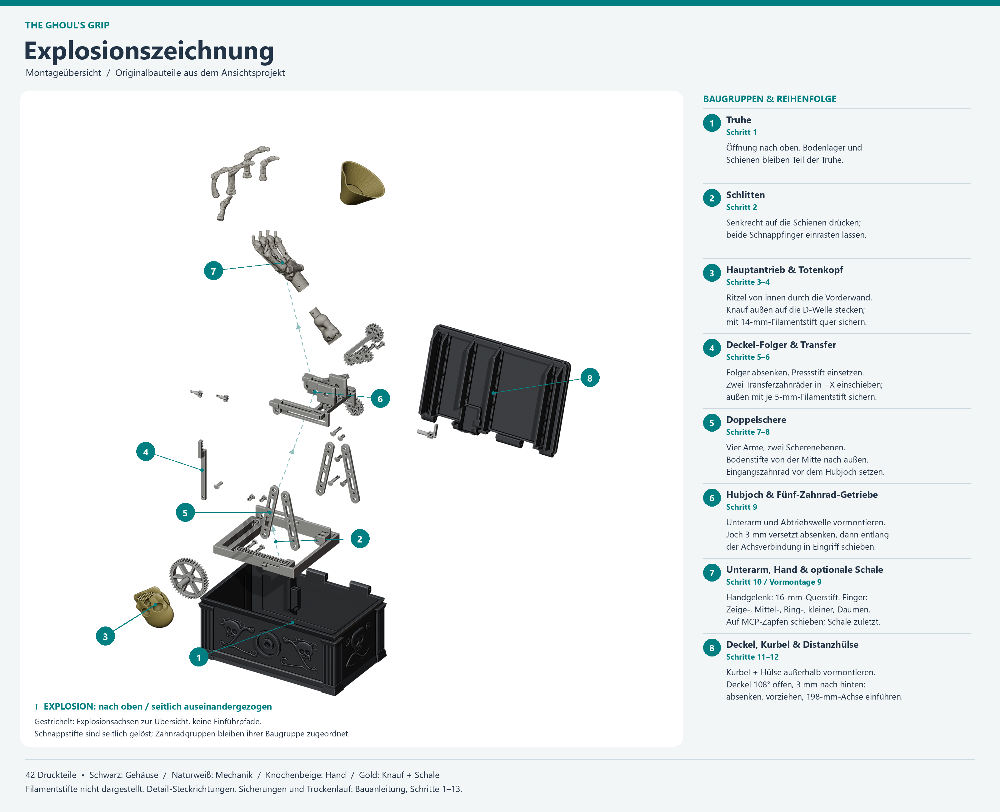](images/ghouls-grip-explosionszeichnung.png)

[Explosionszeichnung in voller Auflösung öffnen](images/ghouls-grip-explosionszeichnung.png).
Die Bildnummern 1–8 bezeichnen **Baugruppen**, nicht die untenstehenden
Arbeitsschritte. Die gestrichelten Pfeile sind Darstellungsachsen, keine
Einführpfade. Besonders Hubjoch und Deckel benötigen die beschriebenen Versätze.
Die Filamentstifte sind im Bild nicht dargestellt.

Stelle die Truhe mit der Öffnung nach oben und der Totenkopf-Bohrung zu dir.
„Vorn“ ist die Knaufseite (−Y), „hinten“ die Scharnierseite (+Y).
Von dieser Vorderseite aus gesehen zeigt +X nach rechts, −X nach links;
+Z zeigt nach oben. Das Scharnier läuft quer von links nach rechts.
Die Bezeichnungen bleiben auch beim Umdrehen des Deckels auf die Truhe bezogen.

### So liest du die Schrittbilder

Jeder Abschnitt von der Teilevorbereitung bis zum Trockenlauf hat eigene
Modellbilder. **A** zeigt die neuen Teile getrennt, **B** das Ergebnis in
Einbaulage. Beim Trockenlauf zeigen A und B stattdessen eingefahrenen und
ausgefahrenen Zustand. Die türkisen Nummern gehören zur Legende direkt unter
dem jeweiligen Bild, nicht zu den Baugruppennummern der Explosionszeichnung.

Bereits zugeordnete Teile sind grau; neue Teile behalten ihre Materialfarbe.
In den gekennzeichneten Detailansichten ist die Truhe ausgeblendet, damit
Lager, Zahnradketten und Stifte sichtbar bleiben. Die Bildabstände sind zur
Lesbarkeit vergrößert: **Steckrichtung und tatsächliche Versätze stehen im
Text**. Filamentstifte sind nicht dargestellt. Alle Bilder lassen sich durch
Anklicken in voller Auflösung öffnen.

[Übersicht aller zwölf Schrittbilder](images/ghouls-grip-montage-bildfolge.png).

## 2. Teile und Arbeitsplatz vorbereiten

[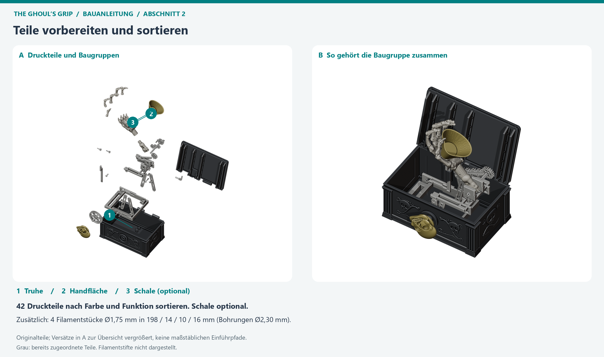](images/ghouls-grip-montage-02.png)

Lege die Teile auf einer weichen Unterlage aus. Hilfreich sind Seitenschneider,
eine kleine Zange, Pinzette, Messschieber und feine Entgratwerkzeuge.
Schneide Filament und entferne Stützmaterial mit Abstand zu Fingern und Augen;
beim Prüfen nicht in Scheren, Zahnräder oder Scharniere greifen.

| Baugruppe im Bild | Teile bereitstellen |
| --- | --- |
| 1 – Gehäuse | 1 schwarze Truhe |
| 2 – Schlitten | 1 naturweißer Schlitten (geschlossener Kastenrahmen mit Querstreben, Zahnstange und verstärkter Kurvenbahn) |
| 3 – Hauptantrieb | 1 Ritzel mit D-Welle, 1 goldener Totenkopfknauf |
| 4 – Deckelantrieb | 1 Folger-Zahnstange, 2 Transferzahnräder mit geschlitztem Klips-Zapfen, 1 Folger-Pressstift |
| 5 – Schere | 4 Arme, 1 Scheren-Eingangszahnrad; passende Gelenkstifte |
| 6 – Hubjoch | 1 Plattform, 3 Zwischenräder, 1 Abtriebsrad mit D-Welle; passende Gelenkstifte |
| 7 – Arm und Hand | 1 Unterarm, 1 Handfläche, 5 unterschiedliche Finger; optional 1 goldene Schale |
| 8 – Deckel | 1 schwarzer Deckel, 1 Deckelkurbel, 1 Kurbel-Distanzhülse |

Entferne Stützen und lose Grate besonders aus Zahnlücken, Schlittenführungen,
Schnappschlitzen, D-Aufnahmen und Querbohrungen. An den Knochenübergängen keine
Kerben einsägen: Die Fingergelenke sind absichtlich **massiv und unbeweglich**.
Passflächen nicht pauschal aufbohren oder abschleifen. Klemmt eine Verbindung,
zuerst Stützreste, Orientierung und passende Stiftvariante prüfen.

### Filamentstifte zuschneiden

Verwende gerades PLA-Filament Ø1,75 mm (±0,02 mm) und entgrate die Schnittenden.
Alle Querbohrungen für Filamentstifte in den Mechanik-, Knauf-, Unterarm- und
Handteilen sind im CAD auf **Ø 2,30 mm (`r = 1,15 mm`)** ausgelegt, um die
Innenschrumpfung beim 5-Wand-/100-%-Füllungsdruck auszugleichen. Die beiden
kleinen Deckel-Transferzahnräder benötigen **keinen** Filamentstift mehr, da
ihre Lagerzapfen geschlitzte Schnappklipse (wie die Gelenksplinte) besitzen.

| Anzahl | Länge je Stück | Verwendung |
| ---: | ---: | --- |
| 1 | 198 mm | Deckelscharnier, durch Truhe, Deckel, Kurbel und Distanzhülse |
| 1 | 14 mm | Knauf und Hauptantriebswelle quer sichern (Bohrung Ø2,30 mm) |
| 1 | 10 mm | Unterarm-Abtriebswelle außen quer sichern (Bohrung Ø2,30 mm) |
| 1 | 16 mm | Handgelenk quer sichern (Bohrung Ø2,30 mm) |

### Gedruckte Stifte sortieren (4 optische Längengruppen + 1 Pressstift)

Insgesamt gibt es **14 gedruckte Stifte**: **13 geschlitzte Schnappstifte (Splinte)**
mit Rastnase und **1 massiven Pressstift ohne Schlitz** (`pivot-pin-follower`).
Wenn du die **13 geschlitzten Splinte** nebeneinander auf den Tisch legst,
erkennst du mit bloßem Auge **vier Längengruppen** (**3 ganz kurze**, **2 kurze**,
**5 lange**, **3 ganz lange**):

| Optische Gruppe auf dem Tisch | Anzahl | Gesamtlänge (Klemmlänge) | Projektkennung | Wo gehört dieser Splint hin? |
| --- | ---: | --- | --- | --- |
| **1. Drei ganz kurze** (mit Schlitz) | **3×** | **10,0 mm** (6,8 mm) | `pivot-pin-short` (`fixed-0`, `slot-0`, `slot-1`) | **Abschnitt 8 (Hubjoch in Schere):** die **3 oberen Gelenke ohne Zahnrad** – 1× oberer Festpunkt vorn (`−Y`) und 2× obere Langlochpunkte vorn/hinten (`−Y` und `+Y`) |
| **2. Zwei kurze** (mit Schlitz) | **2×** | **11,6 mm** (8,4 mm) | `pivot-pin-centre` (`centre-0`, `centre-1`) | **Abschnitt 5 (Scherenebenen):** die **2 mittleren Scheren-Kreuzungen** (je 1× vorn und hinten in der Mitte des X) |
| **3. Fünf lange** (mit Schlitz, optisch fast gleich lang) | **5×** | **2× 14,4 mm** (11,2 mm)<br>**3× 14,6 mm** (11,4 mm) | `pivot-pin-slider` (2×)<br>`pivot-pin-idler` (3×) | **Abschnitt 5:** **2× (14,4 mm)** unten beweglich am **Schlitten** (vorn/hinten)<br>**Abschnitt 7:** **3× (14,6 mm)** für die **3 Zwischenräder** am Hubjoch *(0,2 mm Unterschied liegt im Axialspiel)* |
| **4. Drei ganz lange** (mit Schlitz) | **3×** | **2× 21,6 mm** (18,4 mm)<br>**1× 19,6 mm** (16,4 mm) | `pivot-pin-floor` (2×)<br>`pivot-pin-gear` / `fixed-1` (1×) | **Abschnitt 5:** die **2 längsten (21,6 mm)** unten fest in die **Bodenlager** der Truhe (von innen nach außen)<br>**Abschnitt 8:** der **1 etwas kürzere (19,6 mm)** oben hinten (`+Y`) durch **Hubjoch, Schere und Eingangszahnrad** |
| **Sonderstift ohne Schlitz** (massiv, mit Quetschrippen) | **1×** | **13,1 mm** (Presssitz, Schaft 11,5 mm) | `pivot-pin-follower` | **Abschnitt 4 (Deckel-Folger):** durch die Folger-Zahnstange komplett durch die verstärkte Kurvenbahn des Schlittens bis fast an die Truheninnenwand (`y = 57,5 mm`, 0,5 mm vor der Wand bei `y = 58,0 mm`; kein Gelenksplint!) |

Schnappstifte immer von der Kopfseite durch die fluchtenden Bohrungen einschieben,
bis die geschlitzte Rastnase hinter der Gegenfläche einrastet. Nicht mit einem Hammer
einschlagen. Der Kopf darf das Gelenk nicht festklemmen.

## 3. Schlitten und Hauptantrieb montieren

**Bildgruppen 1–3 · ursprüngliche Montageschritte 1–4**

[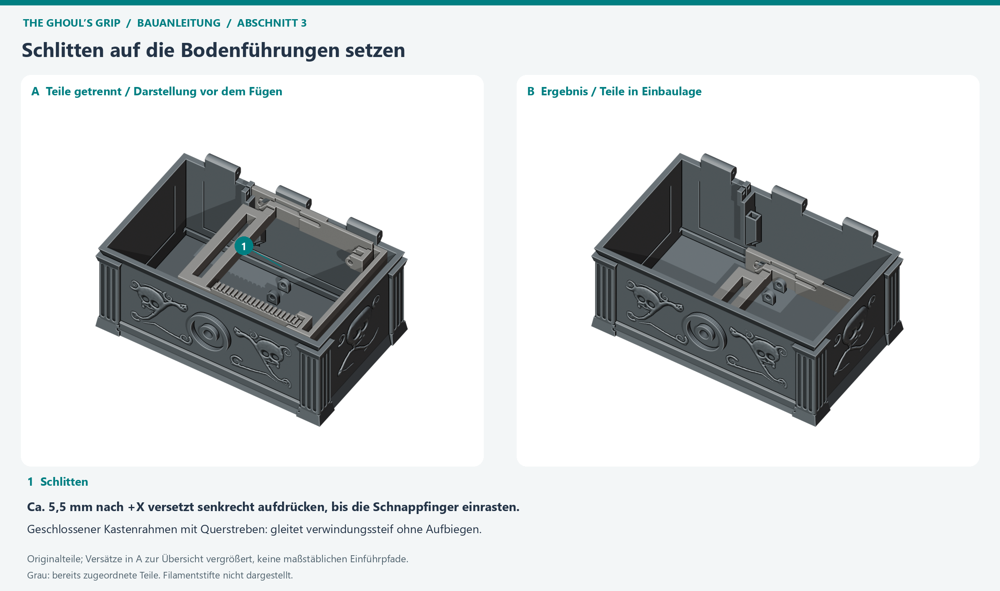](images/ghouls-grip-montage-03a.png)

Setze den Schlitten leicht nach rechts (`+X`, ca. 5,5 mm vor die hintere
Führungsrippe der Truhe) versetzt senkrecht auf die Bodenführungen, drücke nur
an stabilen Rahmenbereichen, bis beide integrierten Schnappfinger in die Nut
greifen, und schiebe ihn dann nach links (`−X`) in die Ausgangslage. Durch die
beiden hinteren Querstreben bildet der Schlitten einen geschlossenen
Kastenrahmen, der sich unter Last nicht aufbiegen kann. Bewege ihn vorsichtig
von Hand durch seinen Weg: Er soll geführt bleiben, aber ohne Verkanten gleiten.

[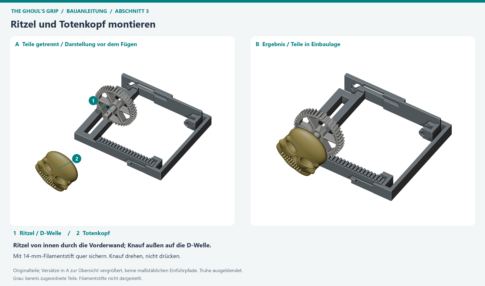](images/ghouls-grip-montage-03b.png)

Führe das Hauptantriebsritzel **von innen** axial durch die Bohrung in der
Vorderwand. Die Zähne müssen in die Schlittenzahnstange greifen.
Bringe den Schlitten in die geschlossene Ausgangsstellung, ohne ihn gewaltsam
gegen einen Anschlag zu drücken. Stecke außen den Totenkopf mit senkrechtem
Gesicht auf die D-Welle; sichere die fluchtenden Querbohrungen mit dem
**14-mm-Filamentstift**.

**Zwischenprüfung:** Eine kleine Knaufdrehung bewegt den Schlitten, ohne dass
die Zähne überspringen. Der Knauf ist ein Drehantrieb, kein Druckknopf.

## 4. Deckel-Folger und Transferzahnräder einsetzen

**Bildgruppe 4 · ursprüngliche Montageschritte 5–6**

[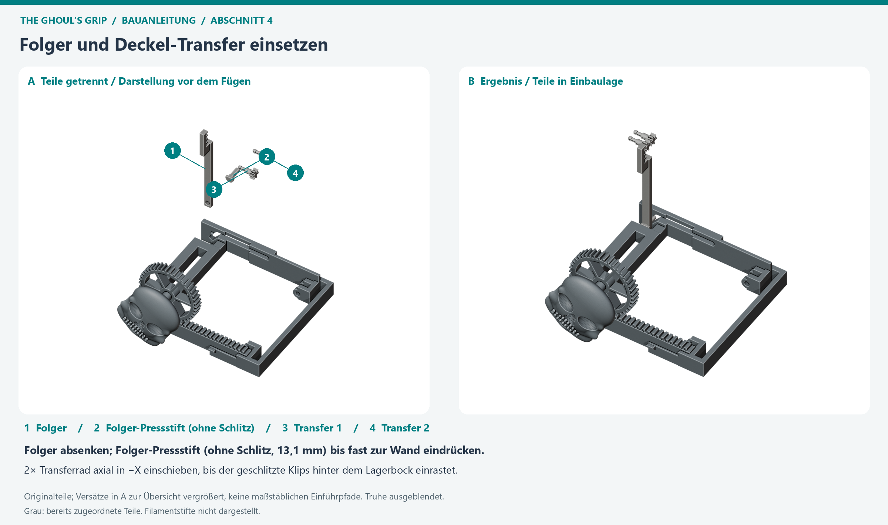](images/ghouls-grip-montage-04.png)

Senke die Folger-Zahnstange in ihren Führungskanal. Drücke den **einzelnen
massiven Folger-Pressstift (13,1 mm Gesamtlänge, ohne Längsschlitz, mit
Quetschrippen)** von innen durch den Folger in den verstärkten Kurvenschlitz
des Schlittens. Der verlängerte Bolzen durchgreift die auf 6,0 mm verbreiterte
Kurvenführung vollständig und reicht bis auf 0,5 mm an die Truheninnenwand
heran (`y = 57,5 mm`), sodass er auch unter Last nicht nach innen aus der
Führung rutschen kann. Verwechsle ihn nicht mit den geschlitzten
Scherensplinten. Die Rippen dieses Stifts bilden den vorgesehenen Presssitz.

Schiebe beide Transferzahnräder (`Transfer 1` und `Transfer 2`) axial in **−X**
durch ihre Lagerböcke, bis der Bund innen anliegt und die **integrierte
geschlitzte Rastnase (Klips, wie bei den Gelenksplinten)** außen hinter dem
Lagerbock hör-/spürbar einrastet. Ein kurzes 5-mm-Filamentstück wird hier
**nicht** mehr benötigt (da sich Filament nicht umbiegen lässt und aus dem
kleinen Zapfen wandern würde). Die beiden Räder übertragen die Bewegung weiter
zur später montierten Deckelkurbel.

**Zwischenprüfung:** Beim vorsichtigen Verschieben des Schlittens steigt der
Folger zunächst an und bleibt anschließend auf dem oberen Abschnitt der
Kurvenbahn. Er darf weder aus der Führung springen noch verkanten.

## 5. Beide Scherenebenen aufbauen

**Bildgruppe 5 · ursprünglicher Montageschritt 7**

[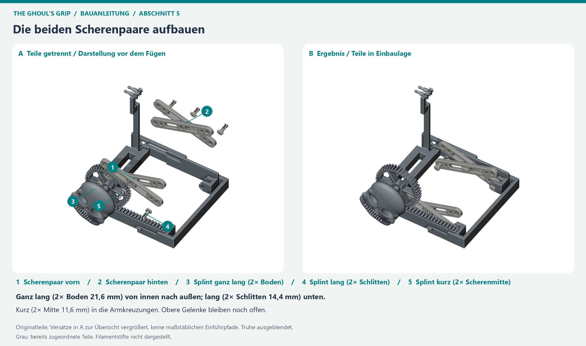](images/ghouls-grip-montage-05.png)

Ordne je zwei Arme als gekreuztes Paar an den beiden seitlichen Scherenebenen
an. Die Arme verbinden unten je einen festen Bodenpunkt und einen beweglichen
Schlittenpunkt; oben folgen ein Festpunkt und ein Langlochpunkt am Hubjoch.
Die Bohrungssenkungen zeigen jeweils nach außen.

Beginne in der flachen Scherenstellung (**18°**). Hier werden **6 Splinte aus
drei verschiedenen Längengruppen** verbaut:

1. **Unten fest im Truhenboden (`pivot-pin-floor`, 2× aus der Gruppe „drei ganz lange“, 21,6 mm – die beiden längsten Stifte überhaupt):** Zuerst einsetzen, solange der mittlere Raum noch gut zugänglich ist – **vom Kisteninneren nach außen** durch beide Wangen des Bodenlagers, niemals durch die geschlossene Außenwand.
2. **Unten beweglich am Schlitten (`pivot-pin-slider`, 2× aus der Gruppe „fünf lange“, 14,4 mm):** Von innen nach außen durch das untere bewegliche Scherenauge und die Schlittenaufnahme stecken.
3. **Scherenmitte (`pivot-pin-centre`, die kompletten „zwei kurzen“, 11,6 mm):** Von innen nach außen durch den mittleren Kreuzungspunkt der beiden Scherenarme je Ebene stecken.

Die oberen vier Gelenkpunkte der Schere bleiben bis zum Einsetzen des Hubjochs (Abschnitt 8) frei.

**Zwischenprüfung:** Beide Paare müssen gemeinsam und ohne seitliches
Verziehen beweglich sein. Lose Teile dabei abstützen. Sind Bohrungen nicht
fluchtend, nicht mit dem Stift in Position hebeln.

## 6. Scheren-Eingangszahnrad vor dem Hubjoch setzen

**Bildgruppe 5 · ursprünglicher Montageschritt 8**

[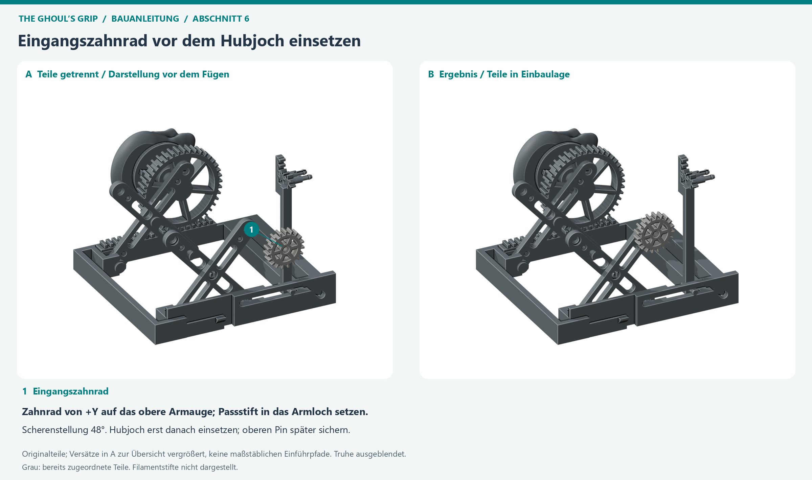](images/ghouls-grip-montage-06.png)

Bringe die abgestützte Schere für diesen Eingriff in die **48°-Stellung**.
Schiebe das Eingangszahnrad von **+Y** auf das obere Armauge, richte seinen
Passstift zum Armloch aus und setze es in Lage. Dieses Zahnrad muss **vor**
der Plattform eingesetzt werden; danach ist der Einführraum eingeschränkt.
Die endgültige obere Gelenksicherung erfolgt beim Einbau des Hubjochs.

**Zwischenprüfung:** Der Passstift sitzt im vorgesehenen Armloch.
Das Zahnrad darf nicht nur lose auf der Armfläche aufliegen.

## 7. Hubjoch und Unterarm außerhalb vormontieren

**Bildgruppen 6–7 · ursprünglicher Montageschritt 9**

[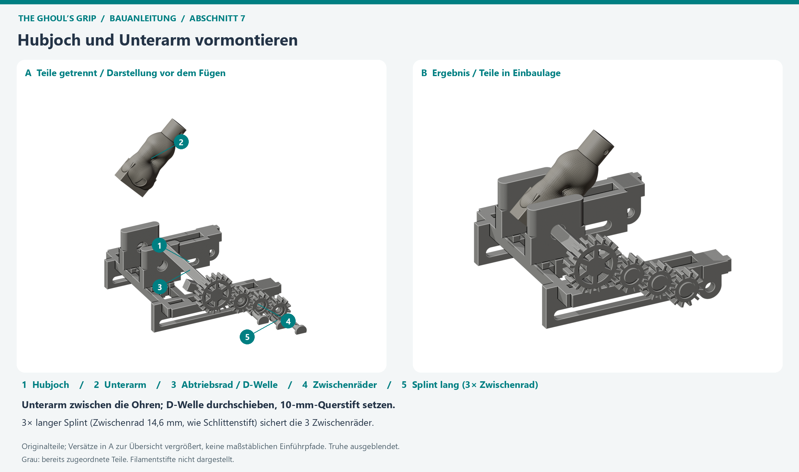](images/ghouls-grip-montage-07.png)

Lege die Plattform außerhalb der Truhe bereit. Setze den Unterarm zwischen
die Lagerohren. Führe die D-Welle des Unterarm-Abtriebsrads axial durch die
Lager und die passende Unterarm-D-Aufnahme. Sichere die Welle außen mit dem
**10-mm-Filamentstift**.

Setze die drei Zwischenräder an ihre Lagerstellen und sichere sie mit den
**verbleibenden 3 Splinten aus der Gruppe „fünf lange“ (`pivot-pin-idler`,
14,6 mm)**. Ihre Köpfe tauchen in die flachen Senkungen der Zwischenräder ein.
Zusammen mit Scheren-Eingangsrad und Unterarm-Abtriebsrad entsteht die
Fünf-Zahnrad-Kette.

**Zwischenprüfung:** Die drei Zwischenräder und das Abtriebsrad stehen in
einer gemeinsamen Eingriffsebene. Die Welle ist gesichert, der Unterarm
kann sich mit dem Abtriebsrad bewegen.

## 8. Hubjoch in die Schere einsetzen

**Bildgruppe 6 · Fortsetzung des ursprünglichen Montageschritts 9**

[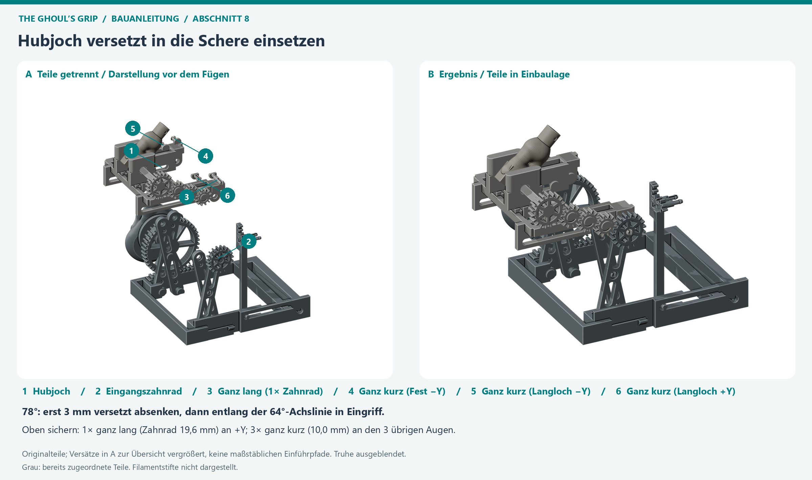](images/ghouls-grip-montage-08.png)

Bringe die abgestützte Schere in die ausgefahrene Stellung (**78°**).
Halte die vormontierte Plattform zunächst **3 mm vom
Scheren-Eingangszahnrad weg**, in Richtung des ersten Zwischenrads, versetzt.
Senke sie in dieser versetzten Lage ab. Schiebe sie erst danach entlang der
Verbindungslinie der Zahnradachsen in den Eingriff.

**Nicht einfach senkrecht in die Verzahnung drücken:** Die Achsverbindung
liegt 64° zur Senkrechten; gerades Absenken würde Zahn auf Zahn treffen.
Schließe nach dem Ausrichten die vier oberen Gelenke mit den **letzten 4
übrig gebliebenen Splinten**:

- **1× der letzte „ganz lange“ Splint (`pivot-pin-gear` / `fixed-1`, 19,6 mm):** Oben hinten (**+Y**) durch Hubjoch-Lager, oberes Scherenauge **und** das Scheren-Eingangszahnrad.
- **Alle „drei ganz kurzen“ Splinte (`pivot-pin-short`, 3× 10,0 mm):** In die übrigen drei oberen Gelenke ohne Zahnrad – **1×** oberer Festpunkt vorn (**−Y**, `fixed-0`) sowie **2×** obere Langlochpunkte vorn und hinten (**−Y** `slot-0` und **+Y** `slot-1`).

**Zwischenprüfung:** Beide Scheren tragen das Joch. Die oberen beweglichen
Punkte laufen in ihren Langlöchern; die fünf Zahnräder greifen ineinander.
Bei Widerstand wieder aus dem Eingriff nehmen und die Zahnstellung prüfen.

## 9. Handfläche, Finger und optionale Schale montieren

**Bildgruppe 7 · ursprünglicher Montageschritt 10**

[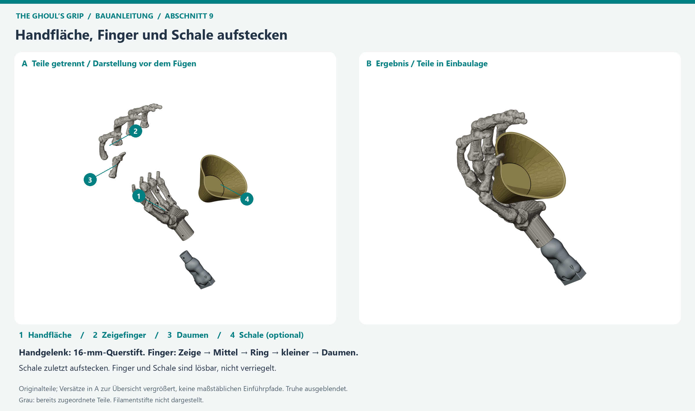](images/ghouls-grip-montage-09.png)

Lass die Mechanik ausgefahren und abgestützt. Richte die Handfläche wie im
Ansichtsprojekt aus: gegenüber dem Unterarm-Bezug um **−75° gerollt**.
Schiebe die Aufnahme auf den Unterarmzapfen, bis die Querbohrungen fluchten,
und setze den **16-mm-Filamentstift** quer ein.

Stecke die Finger einzeln auf ihre jeweils passenden angewinkelten
MCP-Zapfen. Reihenfolge: **Zeigefinger → Mittelfinger → Ringfinger →
kleiner Finger → Daumen**. Führe jede Aufnahme vom freien Zapfenende entlang
seiner Achse zum Handteller. Nicht senkrecht über alle Zapfen drücken und
nicht an den Fingergelenken biegen. Die Steckkrägen schließen bündig an
die freigestellten Mittelhandköpfchen an.

Optional: Richte die drei asymmetrisch angeordneten Unterseitenstifte der
goldenen Schale zu den drei bündigen Sacklöchern der Handfläche aus.
Stecke die Schale von oben entlang ihrer Öffnungsnormalen ein, ohne
Finger oder Knochen als Hebel zu benutzen.

**Zwischenprüfung:** Handgelenk quer gesichert, alle fünf Finger korrekt
zugeordnet, Schale ohne Spannung eingesetzt. Finger und Schale sind
lösbare Steckteile, **nicht verriegelt**; beim Kippen oder Zerlegen festhalten.

## 10. Deckelkurbel und Distanzhülse am losen Deckel vormontieren

**Bildgruppe 8 · ursprünglicher Montageschritt 11**

[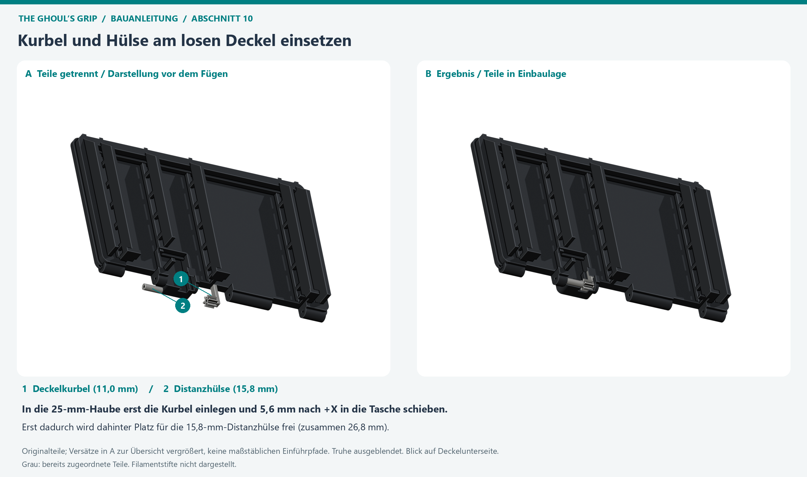](images/ghouls-grip-montage-10.png)

Lege den Deckel umgedreht auf eine weiche Unterlage. Führe die Deckelkurbel
von unten ein und schiebe sie **5,6 mm in +X** in ihre Mitnehmertasche.
Lege die Distanzhülse von unten in den Servicekanal zwischen Kurbel und
Deckelauge. Halte die losen Teile beim Wenden in Position.

**Warum sind Deckelkurbel und Distanzhülse zwei getrennte Teile statt eines?**
Die geschlossene Schutzhaube unter dem Deckel hat nur eine **25,0 mm breite
Öffnung** (`x = −43,0 .. −18,0 mm`), während Kurbel (**11,0 mm**) und
Distanzhülse (**15,8 mm**) zusammen **26,8 mm** lang sind. Außerdem muss der
Mitnehmer der Kurbel seitlich (**5,6 mm in +X**) in die geschlossene Tasche der
Haubenwand eingeschoben werden. Ein einteiliges Bauteil ließe sich deshalb
geometrisch gar nicht in die Haube einsetzen: Erst wenn die kurze Kurbel nach
rechts (+X) in die Tasche geschoben ist, wird dahinter (−X) der 15,8-mm-Raum
frei, in den die Distanzhülse von unten eingelegt wird, um die Kurbel formschlüssig
gegen Zurückrutschen zu sperren.

**Hinweis zur Filamentbohrung:** Da Kurbel und Distanzhülse stehend gedruckt
werden (Bohrung vertikal in Z mit 5 Wandlinien und 100 % Füllung), ist ihre
CAD-Bohrung auf **Ø 2,30 mm** (`r = 1,15 mm`) vergrößert, damit das 1,75-mm-Filament
genauso leichtgängig hindurchgleitet wie durch die horizontal gedruckten
Deckelscharnieraugen. Falls ein älterer Druckstand mit Ø 2,00 mm vorliegt, die
Bohrung beider Teile mit einem **2,0-mm-Bohrer** von Hand aufreiben.

**Wichtig:** Erst danach den Deckel an die Truhe setzen. Bei montiertem Deckel
ist der Servicekanal geschlossen und die Kurbel nicht mehr von unten einsetzbar.

**Zwischenprüfung:** Kurbelmitnehmer sitzt in der Tasche; Kurbel, Hülse und
Scharnieraugen liegen auf derselben Achse.

## 11. Deckel ansetzen und Scharnierachse einführen

**Bildgruppe 8 · ursprünglicher Montageschritt 12**

[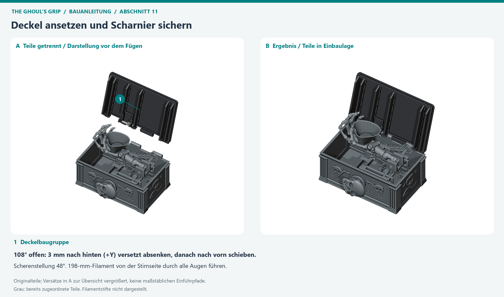](images/ghouls-grip-montage-11.png)

Bringe die Mechanik vorsichtig in die **48°-Scherenstellung**; der Deckelantrieb
befindet sich dabei im geöffneten Zustand. Halte die Deckelbaugruppe etwa
**108° geöffnet** und zunächst **3 mm nach hinten (+Y)** versetzt.
Senke sie ab und schiebe sie dann nach vorn in den Eingriff mit dem
Transfer-Zwischenrad, bis die Gelenkaugen fluchten.

Schiebe das **198-mm-Scharnierfilament von der Stirnseite** durch Truhe,
Deckel, Kurbel und Distanzhülse. Stütze den Deckel währenddessen ab.
Bei Widerstand die Augen ausrichten, nicht mit dem langen Filamentstift
die Baugruppen zusammenzwingen. Die Hülse hält die Kurbel axial im Eingriff.

**Zwischenprüfung:** Achse vollständig eingeführt, Distanzhülse vorhanden,
Deckelkurbel mit dem Deckel verbunden. Der Deckel wird vom Getriebe geführt;
nicht unabhängig gegen den Antrieb zu- oder aufklappen.

## 12. Trockenlauf und Abnahme

[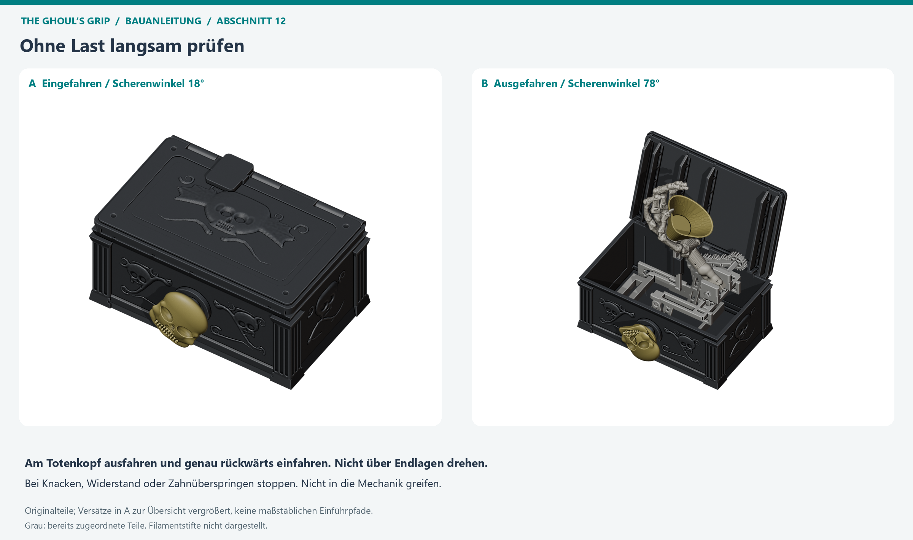](images/ghouls-grip-montage-12.png)

Teste zunächst **ohne Süßigkeiten und ohne Last**. Drehe ausschließlich den
Totenkopf langsam über den vorgesehenen Weg von ungefähr 114° und danach
genau zurück. Nicht über die Endlagen drehen.

- [ ] Der Deckel öffnet früh und bleibt frei vom Bewegungsraum der Hand.
- [ ] Beide Scheren heben gleichmäßig; kein Arm streift an der Truhenwand.
- [ ] Der Unterarm entfaltet sich mit dem Hub und faltet sich beim Rücklauf ein.
- [ ] Die Hand samt optionaler Schale passt eingefahren vollständig hinein.
- [ ] Kein Zahn überspringt, kein Stift wandert heraus, kein Schnappgelenk klemmt.
- [ ] Der Deckel schließt ohne Druck von Hand; lose Finger und Schale bleiben sicher sitzen.

**Bei Knacken, starkem Widerstand oder Zahnüberspringen sofort stoppen.**
Entlaste die Mechanik und behebe die Ursache, statt mehr Kraft am Knauf
aufzubringen. Eine bestandene digitale Prüfung ersetzt diese Kontrolle am
gedruckten Exemplar nicht. Keine bestätigte Nutzlast oder PLA-Dauerfestigkeit;
nicht unbeaufsichtigt belasten.

Für Süßigkeiten nur verpackte Ware oder einen lebensmittelechten Einsatz
verwenden. Ungeschütztes FDM-PLA ist nicht als lebensmittelecht zertifiziert.
Nicht über die im geschlossenen Zustand verbleibende freie Höhe füllen.

## 13. Typische Montageprobleme und Demontage

| Problem | Zuerst prüfen |
| --- | --- |
| Schlitten klemmt | Stützreste in der Führung, beide Schnappfinger korrekt in der Nut, Rahmen nicht verkantet |
| Schnappstift rastet nicht ein | passende Klemmlänge, fluchtende Bohrungen, freie Schlitzhälften; keinen kürzeren Stift erzwingen |
| Hubjoch lässt sich nicht einsetzen | 78°-Stellung, Eingangszahnrad bereits gesetzt, 3-mm-Versatz vor dem Eingriff |
| Deckelkurbel lässt sich nicht montieren | Deckel wieder abnehmen; Kurbel und Hülse müssen am losen Deckel vormontiert werden |
| Deckelantrieb springt über | Transferzahnräder gesichert, Kurbelmitnehmer in Tasche, Distanzhülse eingesetzt |
| Hand oder Finger passen nicht | passende D-/Zapfenausrichtung, Fingerzuordnung und freie Stützreste; Knochen nicht aufbiegen |
| Stift wandert axial | Betrieb stoppen und Sicherung kontrollieren; besonders bei älteren gedruckten Bodenpins |

Vor dem Zerlegen die Mechanik entlasten und Deckel sowie Hand abstützen.
Schale abheben, Filamentstifte herausziehen und in umgekehrter Reihenfolge
zerlegen. Schnappstifte von der Nasenseite durch Zusammendrücken der
Schlitzhälften lösen, nicht mit Gewalt am Kopf herausreißen.

**Ältere Druckstände:** Im Maßdokument sind frühere Bodenpins ohne neue
Verriegelung beschrieben. Die aktuelle Stückliste verwendet Schnappstifte;
beides nicht allein anhand der Farbe gleichsetzen. Bei unbekanntem Druckstand
zuerst die Teile mit dem tatsächlich verwendeten Druckprojekt vergleichen.

## Quellen und Grenzen

Maße, Steckrichtungen und Reihenfolge stammen aus der
[Maß- und Konstruktionsdokumentation](ghouls-grip-masse-und-bauanleitung.md#montageschritte).
Die für einzelne Eingriffe angegebenen Scherenstellungen stammen aus dem
[Montageaudit, Abschnitte 5–6](ghouls-grip-montage-audit.md).
Die Winkel sind **Scherenwinkel**, nicht Knaufwinkel.
Das [Ansichtsprojekt](../models/ghouls-grip-view.3mf) enthält die Stellungen
18°, 48° und 78° als räumliche Orientierungshilfe.
Die Explosionszeichnung zeigt unveränderte Originalnetze, ist aber keine
maßstäbliche Montagelehre. Diese Anleitung ändert weder Geometrie noch
[Druck-/Profilstatus](ghouls-grip-druckvalidierung.md).

### Schrittbilder reproduzieren

`scripts/render_ghouls_grip_assembly.py` liest ausschließlich die vorhandenen
42 Körper in den drei Stellungen der Ansichts-3MF. Blender rendert daraus
zwölf Bildpaare; Pillow ergänzt deutsche Legenden und die Gesamtübersicht.
Es werden nur Präsentationsverschiebungen angewendet, keine Druckkörper
verändert oder exportiert. Bei der Bildfolge wird nicht erneut gesliced.

```powershell
.\.venv\Scripts\python.exe scripts\render_ghouls_grip_assembly.py
```

Die Bilder liegen unter `docs/images/ghouls-grip-montage-02.png` bis
`docs/images/ghouls-grip-montage-12.png` (Abschnitt 3 mit `03a` und `03b`).
Die Übersicht heißt `docs/images/ghouls-grip-montage-bildfolge.png`.
Rohbilder und Kameraprojektionen bleiben unter `build/ghouls-grip-assembly/`.
Der Renderer prüft vollständige Teilezuordnung, Kameragrenzen, nichtleere Bilder
und unveränderte SHA-256-Werte der drei Ghoul’s-Grip-Modelldateien.
