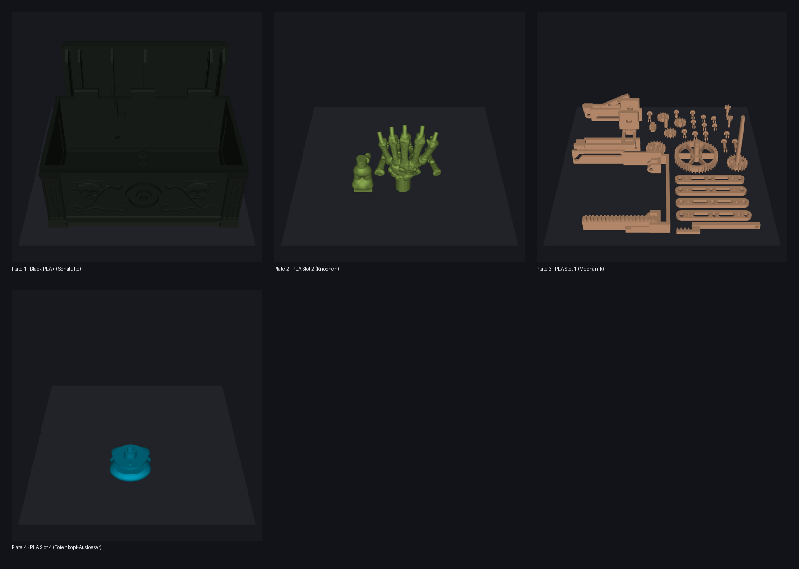
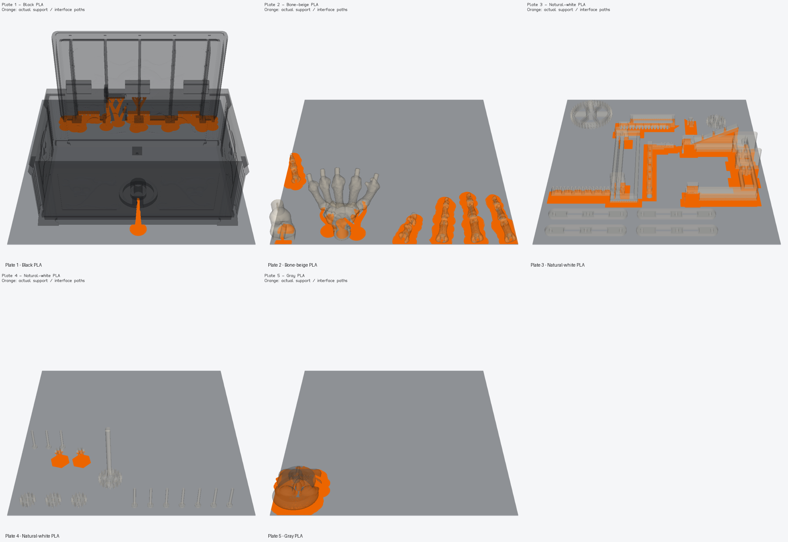
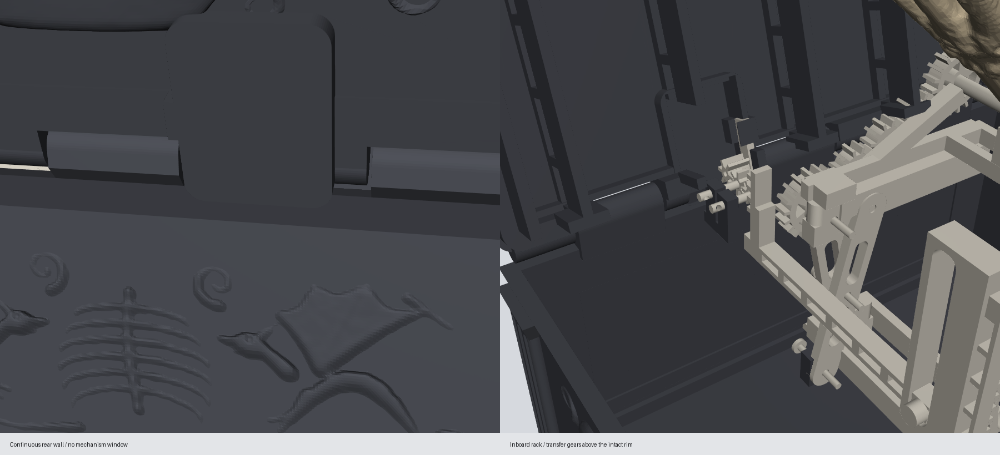
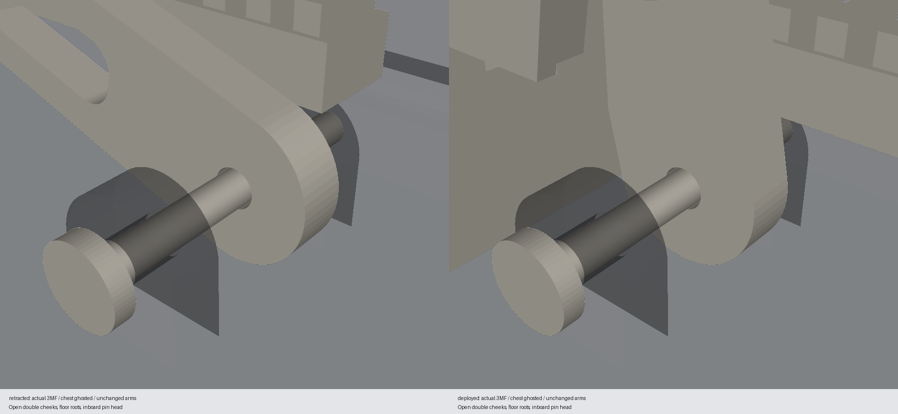

# The Ghoul's Grip – OrcaSlicer Print Validation

Slice result: **verified** with the OrcaSlicer CLI; profile compliance: **verified** (`layer_height = 0.16`, `seam_position = random`, `ironing_type = top`, `support_type = tree(auto)` with `0.16 mm` Z contact distance).

**As of 2026-10-19 (contoured enlarged candy dish, candy hand with solid finger joints, rear-wall/plinth connection + mandatory 0.16-mm/random-seam/tree-support rules):** The print file has four plates and
42 objects (29 part types including spare pins, crank spacer `crank-spacer`, and removable candy dish `candy-dish`; 31 natural-white parts on plate 3, 2 gold PLA parts (`#D4AF37`) on plate 4). The five fingers and opposed thumb (`55°` yaw) are printed directly in a curled, bowl-holding pose with fully closed, solid knuckle transitions (no V-notches or joint gaps); tendon channels were removed, and the MCP plug joints to the palm are tuned to 0.4 mm clearance. The former protruding dish-support ribs on `hand-palm` were replaced by three blind holes recessed flush into the metacarpals (Ø3,4 × 3,6 mm, > 3,5 mm of closed material toward the back of the hand); the short legs and Ø3,0-mm locating pins sit directly on the underside of the `candy-dish`, which is embedded deeper in the hand and contoured larger (`55,1 × 67,5 × 39,8 mm`, `DISH_OFFSET = [-1.5, -2.5, -3.5]`), extends closer to the fingers, thumb, and forearm, and is printed upside down on its flat upper rim. Without the dish inserted, the skeletal hand remains completely smooth and anatomical.
The printed chest was also updated at the rear-wall transition to the plinth (`Z = 8,0 .. 12,0 mm`): in `scripts/gothic_chest.py`, `rail_covers` was rebuilt as a continuous 5-point rib (`Z = 5,0 .. 13,7 mm`, `|y| = 58,0 .. 61,5 mm` with a 45° chamfer to `|y| = 60,0 mm` at `Z = 13,7 mm`), with a continuous `1,50 mm` outer-wall thickness along the guide slot and a `3,50 mm` horizontal bridge at `Z = 12,0 .. 12,2 mm`.
All 3MF files meet the mandatory rules (`layer_height = 0.16`, `seam_position = random`, `ironing_type = top`, `curr_bed_type = Textured PEI Plate`, `support_type = tree(auto)`, `support_top_z_distance = 0.16`, `support_bottom_z_distance = 0.16`). The assembly audit `docs/ghouls-grip-montage-audit.md` and the 61-pose candy-hand audit `docs/ghouls-grip-candy-hand-verifikation.md` pass all checks (10,981 ml static retention volume at 2 mm freeboard, 0,000 mm³ collision with chest, lid, and mechanism).
The final slice was saved on 2026-10-19 in
`build/ghoul-final-slices/print/` (exit 0, four G-code files).
The updated print file has SHA-256
`9CE825990D352A6F3551DB2CF3DB51BBB8F10A285D1E72CAD99BDEC22E4B6172`
and was updated after the slice metadata was saved on 2026-10-19.

History (2026-10-12): The 16 objects from the former natural-white plate 4 were
then consolidated with the 11 main parts on plate 3.
`scripts/consolidate_ghouls_grip_mechanism_plates.py` preserves part
orientations and Z positions, leaves 6 mm between part bounding boxes, and
maintains at least 10 mm from the build-plate edge. The seven bone-colored
objects on plate 2 were then rearranged in XY only; mesh payloads, rotation,
and Z positions were preserved. Their footprint spacing is at least 10 mm,
with at least 68,5 mm clearance from the plate edge. The updated OrcaSlicer
CLI 2.4.2 slice then completed with exit code 0 and four G-code files. That
print-file SHA has since been superseded by the 2026-10-19 version.

Current final SHA-256 (2026-10-19):

| File | SHA-256 |
| --- | --- |
| `models/ghouls-grip-view.3mf` | `DE10F30372E22C0C1DC67924C2A56EF4F27AAD21EB0E54615DF067F3E784AB0C` |
| `models/ghouls-grip-preview.stl` | `24621640E3F4F7480C406D46A46B202325FA383A5FAB40ED777060452EA191B7` |
| `models/ghouls-grip-print.3mf` | `9CE825990D352A6F3551DB2CF3DB51BBB8F10A285D1E72CAD99BDEC22E4B6172` |

Chest: 76.668 facets, 209 × 130,5 × 98 mm, 202.470,353 mm³,
a single closed body, consistent normals, no degenerate triangles. The full
ASCII STL is intentionally an assembled 42-body preview, not a print layout;
42 print objects, including spare pins and the removable candy dish, are in the
four-plate print project. The final view file `models/ghouls-grip-view.3mf` was
opened in the STL Canvas; the rendered color view is also available at
`docs/images/ghouls-grip-view-preview.png`.

History (2026-10-12, 37-object version): The floor-bearing repair at that time
changed only the chest geometry; the other **36 mesh payloads remain byte
identical** to the imported user file (`HEAD`). All 37 mesh payloads, object
overrides, colors, materials, and `project_settings.config` were preserved.
The 16 gear/connector parts now share plate 3 with the 11 main parts; all 37
objects remain present exactly once in the complete bill of materials. The
exact final print file was loaded independently: 37 closed, consistently
oriented individual bodies, zero degenerate triangles, all within their
250-mm build plate, Z bed contact within a 0.01-mm rounding tolerance; the
largest part-to-part intersection volume on a build plate is 0.000 mm³. The
assembled mechanism's arm/floor-bearing pairs now also pass the 61-state
verification; this is not a load rating.
Verification artifact: `build/ghoul-floor-bearing-delivery.json`.

## Visible Supports

**Orange shows actual extruded support and support-interface paths** from the
four fresh G-code files; transparent gray shows the corresponding parts. This
is a G-code toolpath render, not an OrcaSlicer UI screenshot.

Individual views: [Plate 1 – Black](images/ghouls-grip-print-plate-1-supports.png),
[Plate 2 – Bone beige](images/ghouls-grip-print-plate-2-supports.png),
[Plate 3 – Natural white, 31 parts](images/ghouls-grip-print-plate-3-supports.png),
[Plate 4 – Gold](images/ghouls-grip-print-plate-4-supports.png).

The screenshots correspond exactly to the current print file and the four
G-code files generated on 2026-10-19 in
`build/ghoul-final-slices/print/`.
To reproduce:
`python scripts\render_ghouls_grip_print_projects.py build\ghoul-final-slices\print --project models\ghouls-grip-print.3mf`
and
`python scripts\render_ghouls_grip_supports.py build\ghoul-final-slices\print --project models\ghouls-grip-print.3mf`.
The support paths remain a separate image preview and are not overlaid on the
3D model geometry. Canvas and Web UI now also provide direct buttons for each
plate image; clicking one opens the image at full size.
## Profile Contract and Actual User Settings

The user modified the print project in OrcaSlicer. The current settings are
documented here and have not been silently reverted to earlier requirements:

- Printer: `Anycubic Kobra S1 0.4 nozzle`; nozzle/layer height: 0.4 mm / 0.20 mm
- No separately named process profile is stored in the 3MF; the process values
  are embedded in `Metadata/project_settings.config`.
- Filament profile: `Anycubic PLA @Anycubic Kobra S1 0.4 nozzle` for four PLA slots
- In the saved project: bed `High Temp Plate`, seam `aligned`, ironing
  `no ironing`, global `enable_support=0`, global defaults of 2 wall loops and
  15% infill.
- Part overrides enable supports (`enable_support=1`) for the relevant objects;
  all four fresh G-code files contain actual support paths. Plate 3 now contains
  all natural-white parts, including the former transfer gears.
- Supports limited to the build plate, global type `tree(auto)`; some object
  overrides use `normal(auto)`.

This file therefore deviates from the project defaults `Textured PEI Plate`,
`seam=random`, `ironing=top`, and globally enabled supports. Slicing succeeded,
but profile compliance and print readiness are **not verified**. For all four
plates, OrcaSlicer reported that `precise wall` was ignored with the selected
wall sequences. In addition, `stdout.log` contains 489 instances of
`Not precalculated Placeable areas requested, radius 0, layer 0, critical: 0`.
The run nevertheless ended with exit code 0 and generated all four G-code
files; the repeated diagnostic must not be considered resolved. No automatic
repair or rearrangement of the parts was allowed.

## Floor-Bearing Correction, Reproduction, and Release Limit

The central colliding floor posts were rebuilt as short double cheeks around
the unchanged arm sleeves. The 12-mm channel provides 1 mm of axial clearance;
the 4-mm cheeks have 3 mm radial bore walls and directly connected
9,2 × 4 mm floor roots. All new dimensions are design estimates/default
clearances and require PLA fit and load tests; they are not newly claimed
measurements. The existing 26-mm pins are inserted from the center of the
chest; the head of the positive floor pin is mirrored accordingly in the view
project. The print pin and complete bill of materials remain unchanged.

The original wall cutter (14 × 12 × 24 mm at X=-27, Y=58, Z=75) was removed.
The follower yoke rack is 14,854 mm farther inward; two identical transfer
gears provide a 1:1 ratio, 7-mm hub, and 108° lid motion. The new journal
support and asymmetric cover intersect neither the wall nor the central hinge
block. Roof/wall probes confirm continuous material.

During the print refresh, centering by bounds alone placed the taller new crank
below Z=0; OrcaSlicer 2.4.2 then crashed with an access violation. The export
now preserves the original transformed bed-contact plane. Historical finding
from the wall correction: the 31 unaffected payloads at that time were not
re-rounded. Both five individual plate slices and the final `--slice=0` check
then succeeded. The **current final** check on 2026-10-12 using
`scripts/slice_ghouls_grip.ps1` completed after plate consolidation with exit
code 0 and four actual G-code files. The header of each fresh G-code confirms
OrcaSlicer 2.4.2. The actual installation was found at
`C:\Program Files\OrcaSlicer\orca-slicer.exe`;
`--help` exited with code 0 and no console output, so the already-working
options from the existing slice script were used. The external mesh
relationships are serialized without an XML namespace prefix, as expected by
Orca's importer.

| Command / evidence | Result |
| --- | --- |
| `.\.venv\Scripts\python.exe -m unittest discover -s tests` | PASS: 63 tests (as of 2026-10-17) |
| `.\.venv\Scripts\python.exe -m unittest discover -s tests -p test_ghouls_grip_print_refresh.py -v` | passed again after final bed-contact correction; original transforms, overrides, plate assignments, unchanged payloads, and idempotence |
| `.\.venv\Scripts\python.exe -m unittest discover -s tests -p test_slice_support_usage.py -v` | 3 tests passed; M82/M83/G92 and resets |
| `.\.venv\Scripts\python.exe scripts\verify_ghouls_grip_mechanics.py` | Overall verification PASS; 61 scissor positions from 18° to 78° including 48°, all four individual arm/chest pairs now have a hard fail gate at >0,001 mm³; other checked pairs 0 mm³; JSON in `build/ghoul-floor-bearing-verification.json` |
| `python scripts\consolidate_ghouls_grip_mechanism_plates.py` | PASS: all 31 natural-white parts on one plate; at least 10 mm from plate edge, 6 mm frame spacing, part orientations and mesh payloads preserved |
| `python scripts\arrange_ghouls_grip_bone_plate.py` | PASS: seven parts on plate 2 with at least 6 mm footprint spacing and at least 69 mm from plate edge; only XY translations changed |
| `powershell -NoProfile -ExecutionPolicy Bypass -File scripts\slice_ghouls_grip.ps1` | Exit 0 and four fresh OrcaSlicer 2.4.2 G-code files |
| `python scripts\update_ghouls_grip_slice_metadata.py build\ghoul-final-slices\print --project models\ghouls-grip-print.3mf` | PASS: final slice metrics saved; profile status remains `not-verified` |
| `python scripts\verify_ghouls_grip_candy.py --output build\ghoul-candy-verification.json --report docs\ghouls-grip-candy-audit.md` | PASS: 61 poses, 35 frozen non-hand payloads unchanged, >= 11,518 ml static retention volume at 2 mm freeboard, all 61 insertion steps (0..60 mm) clear |
| `python scripts\compact_output.py run --log build\test-assembly.log -- python -m unittest discover -s tests -p test_ghouls_grip_assembly.py -v` | PASS: 8 tests (including solid finger joints, thumb opposition, flush palm blind holes, and dish locating pins), exit 0 |
| `python scripts\render_ghouls_grip_print_projects.py build\ghoul-final-slices\print --project models\ghouls-grip-print.3mf` and `python scripts\render_ghouls_grip_supports.py build\ghoul-final-slices\print --project models\ghouls-grip-print.3mf` | four plate previews, full project preview, and four actual G-code support sidecars |
| `python scripts\mesh_tool.py validate models\ghouls-grip-preview.stl --allow-multibody` | PASS: 274.242 facets, 42 intentionally separate assembled bodies, watertight/orientation-consistent, zero degenerate triangles, Euler number -180; the non-printable assembly preview is offset by 5,898 mm in Y in the center-origin system and was not moved automatically |

**The documented arm/floor-bearing collision has been eliminated:** baseline
496,131 / 519,274 / 554,635 mm³ at 18° / 48° / 78°; currently
0,000 mm³ to three decimal places in all 61 states.
The maximum numerical residual per individual arm is 0,000020464 mm³ at
tangential floor contact, below the 0,001 mm³ Boolean tolerance.
This is explicitly not a mathematically exact zero floating-point value.
All other pairs checked in the full verification are 0 mm³, and the wall
remains 100% solid. Individual pair volumes are in the
[mechanics verification](ghouls-grip-mechanik-verifikation.md).
Physical print/load approval is still pending: PLA fit, support removal from
small cross-holes, axial migration of the existing unlatched floor pins,
journal clearance, tooth profiles, floor load transfer, and fatigue life must
be tested. The slice contains actual supports, whose removal in the small
bearing area still needs physical verification.

## Current Slice Results

| Plate | Contents | Layers | Filament | Supports | Time | View |
| --- | --- | ---: | ---: | ---: | ---: | --- |
| 1 – Black | Chest and lid (2) | 811 | 343,21 g | 6,11 g (1,8 %) | 16 h 01 min 54 s | [Support image](images/ghouls-grip-print-plate-1-supports.png) |
| 2 – Bone beige | Forearm, palm, and fingers (7) | 602 | 46,54 g | 7,57 g (16,3 %) | 3 h 59 min 58 s | [Support image](images/ghouls-grip-print-plate-2-supports.png) |
| 3 – Natural white | Main mechanism, gears, shafts, pins, and crank spacer (31) | 600 | 113,54 g | 11,45 g (10,1 %) | 6 h 02 min 25 s | [Support image](images/ghouls-grip-print-plate-3-supports.png) |
| 4 – Gold | Skull trigger and candy dish (2) | 248 | 37,99 g | 7,03 g (18,5 %) | 2 h 36 min 05 s | [Support image](images/ghouls-grip-print-plate-4-supports.png) |
| **Total** | **42 print objects / 4 plates** | – | **541,28 g** | **32,16 g (5,9 %)** | **28 h 40 min 22 s** | [Overview](images/ghouls-grip-print-support-overview.png) |

| Color group | Time | Mass | Support material | Length | Volume | Plates |
| --- | ---: | ---: | ---: | ---: | ---: | ---: |
| Black (`#202124`) | 57.714 s | 343,21 g | 6,11 g | 115.073,12 mm | 276.780 mm³ | 1 |
| Bone beige (`#D8C6A5`) | 14.398 s | 46,54 g | 7,57 g | 15.603,85 mm | 37.530 mm³ | 1 |
| Natural white (`#F1EBDD`) | 21.745 s | 113,54 g | 11.45 g | 38.068,59 mm | 91.570 mm³ | 1 |
| Gold (`#D4AF37`) | 9.365 s | 37,99 g | 7,03 g | 12.735,82 mm | 30.630 mm³ | 1 |
| **Total** | **103.222 s** | **541,28 g** | **32,16 g** | **181.481,38 mm** | **436.510 mm³** | **4** |

Support portions are calculated from positive extrusions during support/
interface moves; `M82`, `M83`, and `G92` are taken into account, while
extruder-only retractions are not counted as printed support. The previous
absolute-E calculation of relative Orca extrusion was incorrect. Mass and
volume are converted using the ratio from each slice:

| Plate | Support length | Support volume |
| --- | ---: | ---: |
| 1 | 2.049,71 mm | 4.930 mm³ |
| 2 | 2.536,88 mm | 6.102 mm³ |
| 3 | 3.837,66 mm | 9.231 mm³ |
| 4 | 2.356,73 mm | 5.668 mm³ |
| **Total** | **10.780,98 mm** | **25.931 mm³** |

The totals and four individual results are stored as slicer-neutral metadata
in `models/ghouls-grip-print.3mf`; all four plates are marked `not-verified`.
The metadata status remains `not-verified` until profile deviations and CLI
diagnostics have been reviewed. G-code, mesh, and model hashes, together with
the commands run, are recorded in `build/ghoul-floor-bearing-quality.json`;
the full sweep and print checks are in `build/ghoul-floor-bearing-verification.json`
and `build/ghoul-floor-bearing-delivery.json`.
### Historical Orientation Optimization (A/B Tested, Not the Current Slice)

All print orientations are supported by actual A/B slices. The audit scripts
clone the same project template and replace only the build item, so that only
the orientation varies:

| Part | Orientation | Support extrusion | Alternatives |
| --- | --- | ---: | --- |
| Lid | standing on rear edge | **4.598,9 E** | upright 20.336,1 · upside down 20.553,3 · front edge 14.840,6 |
| Palm | standing on wrist cut | **290,0 E** | as built 2.958,9 · mirrored 1.970,5 · on side 2.084,5–3.102,7 |
| Skull knob | face upward on shaft collar | **968,7 E** | as built 3.266,5 · on side 655,8–793,9 (rejected: supports on face) |
| Forearm | as built | **0,0 E** | all tilted variants 318,2–414,1 |

Scripts: `scripts/audit_lid_orientation.py`, `scripts/audit_part_orientation.py`,
`scripts/audit_chest_support.py`.

Historical comparison before this wall correction: compared with the then
verified version (528,22 g / 138,60 g support), support use fell by
**83,21 g / 60,0 %** and total mass by 11,38 g. The measured orientation changes
account for most of the savings; the additional closed lid cover adds only
1,59 g to the black project. Compared with the original 629,66-g design, the
material saving is **112,82 g / 17,9 %**; compared with the pre-lightweighting
chest (455,96 g black), it is **125,00 g / 27,4 %**.

The user version before the wall correction was 77.721 s, 527,20 g filament,
and 28,42 g support. The current change adds 279 s, 1,76 g filament, and
1,36 g support. This difference comes from actual slices; the historical
values do not replace the new results listed above.

## Supports and Object Overrides

- Chest/lid: 3 walls, 10% gyroid, build-plate-only tree supports `tree(auto)`;
  analytically determined maximum lid bridge gap 10,0 mm, chest 6,0 mm.
- Mechanism: 5–6 walls, modeled openings, frames, ribs, and spokes;
  20–50% infill in remaining cavities. Arms and pins are effectively solid
  because of the wall loops.
- Hand/bones: 4 walls, 25%; the palm stands on the wrist cut, so finger pockets
  and the thumb pad print vertically rather than as overhangs.
- Fingers: 2 walls, 15%, 30 mm/s outer wall, and reduced acceleration for the
  slender curved fingers with solid joint transitions.
- Skull knob: 5 walls, 40%, face upward so no supports touch the sculpted surface.
- Candy dish (`candy-dish`): 4 walls, 15%, automatic tree supports (`tree(auto)`),
  placed on its flat bottom beside the skull on plate 4.

## Retained Support/Material Optimization and Wall Correction

- The lid has a 2,4-mm skin, open underside supports, five ribbed longitudinal
  cross-members, and five short rear stop pads instead of a solid 193-mm-wide
  crossbar. It stands on its rear edge: in this orientation neither the hollow
  inner ceiling nor the sculpted cartouche relief is a major overhang
  (4.598,9 rather than 20.336,1 support E).
- The former continuous service channel for the yoke and lid crank is now
  completely closed on the outside. A local black cover has a 2,0-mm roof,
  an assembly cavity open only to the inside, and a measured labyrinth
  clearance at the hinge. In the closed state, every internal mechanism part
  lies beneath this lid geometry; the full 18°–78° sweep gives **0,000 mm³**
  for `lid_crank_lid`, `lid_yoke_lid`, `lid_chest`, and their respective chest
  contacts.
- In the current user file, the chest and upright lid share the same black
  plate; both fit side by side within the 250-mm build plate. The previous
  six-plate layout used two separate black plates for them.
- The chest plinth and upper cornice were changed from horizontal steps to two
  sloped, self-supporting courses. The pilaster capitals and undersides of the
  hinge bearings are sloped as well.
- The decorative chest wall and floor are 2,0 mm thick; the 3,0-mm functional
  datums at the rails, bearings, and guides are retained. Rounded outer edges
  and recessed rather than applied reliefs look more organic and avoid
  additional solid decorative bodies.
- Historical lightweighting step: chest volume decreased from 295.062 to
  184.056 mm³ (**−37,6 %**), and lid volume from 252.068 to 124.903 mm³
  (**−50,5 %**). Together, that is a **−43,5 % model-volume** reduction.
- Eight revised mechanism parts decreased from 118.567 to 82.649 mm³
  (**−30,3 %**) through open frames, windows, and spokes.
- The lid remains a single watertight/manifold body:
  27.868 facets, 206 × 129,786 × 28,2 mm. The current chest is
  199.297,757 mm³, and the lid 134.466,876 mm³. The local protective cover is
  only 2,6 mm taller than the sculpted cartouche relief and contains no
  disconnected or enclosed bodies.
- Rail and bearing Booleans are created first in the proven core shell; the
  sloped decorative courses are then added in a controlled manner. This keeps
  the mechanical guides closed and manifold.
- The updated color plate previews were regenerated from the new 3MF scenes.
  They show material/color grouping, not sliced support volumes.

## Display in Canvas and Web Viewer

The delivered 3MF files contain the verified project values directly in
`Metadata/ghouls_grip_print_metadata.xml`. The shared web/Canvas renderer uses
them to show:

- a compact row with print time, total material, support material, filament
  length, and validation status for **all plates**, regardless of the selected
  view;
- a collapsible detail overlay in the bottom right with machine, nozzle,
  process, filament profile, material, color, bed, wall count, infill,
  supports, and plate count;
- a separately expandable **Print data by plate** table in the detail overlay,
  with print time, material, support material, filament length, support length,
  status, and a support-image button for each sliced plate. The images show the
  support paths actually extruded and can be viewed in a dialog in both Canvas
  and Webview. Missing or invalid plate metadata is explicitly reported;
- a project-preview button for the complete color-coded four-plate print project;
- the correct individual plate or all plates, taking 3MF component transforms
  and OrcaSlicer's `plater_id` into account;
- a collapsible tool menu for reload, auto-reload, zoom, wireframe, shading,
  views, rotation, helper overlays, and measurement.

Multi-plate files open in Canvas and the Web Viewer with **All plates**
selected. More than two plates appear in a grid with 50 mm spacing only in the
overall view; two plates are shown side by side. Individual plate transforms
remain unchanged. Material colors follow OrcaSlicer's filament palette with
object and part assignments; standard 3MF files continue to use their 3MF
material resources.
The print overview shows the embedded project totals (time, material,
supports, and filament length) as well as the plate count. Individual plates
remain selectable through **Plate**. Reloading the same file preserves the
selection; opening a different file selects **All plates** again. Single-plate
3MF and STL files remain unchanged.

Viewer check (2026-10-12): `npm test --prefix web` passed
(22 tests); `npm run build --prefix web` passed. Browser screenshots of the
local Canvas and built web SPA confirm both black build plates in the overview
and the project totals. Individual plate selection, reload, switching to the
view 3MF, and auto-reload of another multi-plate file were also checked.

In the local Copilot Canvas extension, **Open 3MF** opens the exactly selected
workspace 3MF in the registered default application via a local POST endpoint
with nonce checking and path validation. The button is not offered as a
desktop-launch option for STL files, unsafe paths, or the public web SPA.

## Resolved Issues

1. Canvas accounts for 3MF build and component transforms and Orca's `plater_id`; objects no longer overlap.
2. The internal guide has a 1,8-mm outer cover; the chest remains closed externally.
3. All 31 natural-white mechanism parts are grouped without collisions on one
   250-mm plate; each of the 41 print objects is assigned exactly once to one
   of four material plates.
4. The former lever, ratchet slide, spool, keys, strap anchors, ropes, rubber
   bands, and springs have been removed. The gray skull directly turns the
   pinion shaft.
5. `scripts/render_ghouls_grip_print_projects.py` renders all four
   color-coded plate previews directly from the current 3MF file. The saved
   OrcaSlicer plate grid is resolved according to the number of plates (three
   columns for five, two for four plates); 300-mm X and Y offsets are removed
   from individual plate images using the actual plate assignments.

## File Evidence

Print project timestamp: `2026-10-19 15:44:40 UTC`.

| File | SHA-256 |
| --- | --- |
| `ghouls-grip-view.3mf` | `E325A4FDE54291256764328CCEAD007905607471CBA0798D8F6EBAF9ABE1D84B` |
| `ghouls-grip-preview.stl` | `E47873CE3DBB4E2192C9B89E549963A503C60DE109EEEFAF51E5722A193C4C10` |
| `ghouls-grip-print.3mf` | `024B680C48ED15F857201DEC84A029E69912E3578A38DA648FD4A126412659E8` |

## Remaining Physical Risks

- The direct skull drive has less mechanical leverage than the discarded long
  lever. Deburr fits and gear teeth before final assembly.
- Successful slicing and collision-free simulation do not replace a real
  endurance test.
- Printed pins and PLA flexures wear. Secure highly loaded scissor joints with
  M3×16 screws where practical.
- Before printing the complete assembly, an arm/pin/gear fit coupon and a
  single-finger test print are still recommended.
