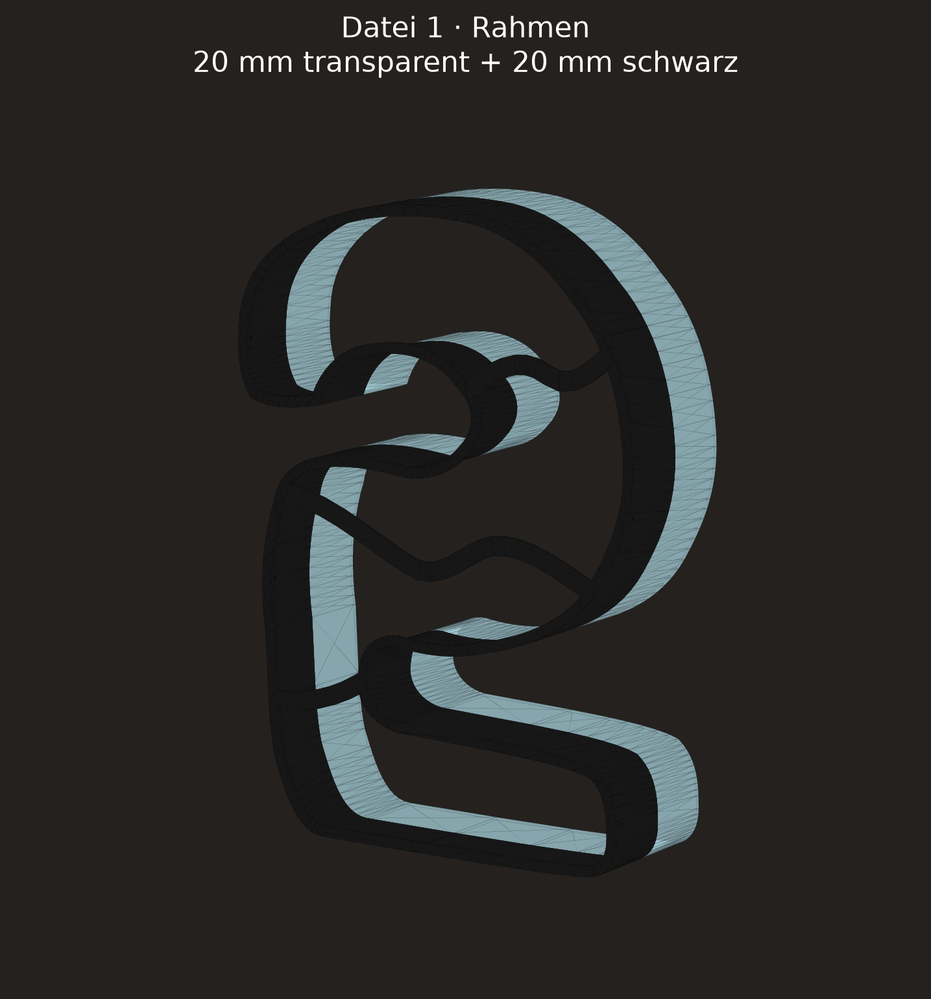
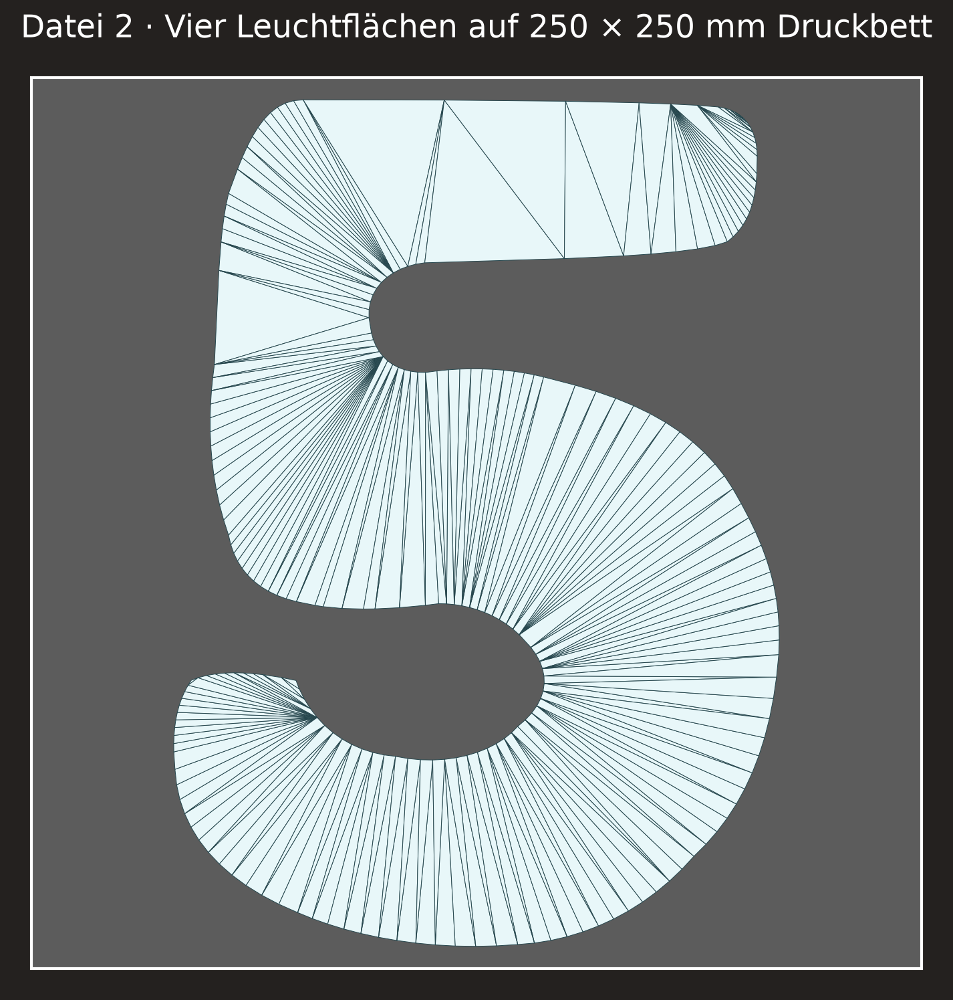

# Number “5” Lamp – Dimensions and Assumptions

## Confirmed Dimensions

| Feature | Value | Source | Confidence |
| --- | ---: | --- | --- |
| Overall height | 240 mm | user statement in PR comment | exact |
| Frame depth | 40 mm | user statement in Issue #21 | exact |
| Overall assembled depth | 42 mm | 40 mm frame + 2 mm overlaid illuminated panel | exact |
| Transparent, wall-side depth portion | 20 mm | user statement in Issue #21 | exact |
| Black, front-side depth portion | 20 mm | user statement in Issue #21 | exact |
| Bearing width of L/T legs | 3 mm | user correction 15.09.2026 | exact |
| Power connection | omitted for now | user comment in Issue #21 | exact |
| Stickers/logos | omitted | user comment in PR | exact |

## Derived from the Reference Image

The single image attachment could not be downloaded in the work container from
the provided URL (the redirected asset host could not be resolved). Therefore,
no pixel-accurate outline is claimed. The parameterized outline incorporates
features that are clearly visible in the image:

- clearly legible number 5 with a rounded top bar and large lower curve,
- four white illuminated panels,
- three curved, continuous dividers,
- smooth transitions from the dividers into the outer frame,
- image-estimated width of about 172 mm at a height of 240 mm.

At the user's request on 15.09.2026, the left connection and center anchor of
the lower divider were moved farther down and smoothed into a continuous S-curve.
This makes illuminated segment 3 larger and segment 4 smaller.

The left connection remains joined to the middle divider; a previously free,
rounded endpoint was removed. The S-curve itself is compactly shaped between
this connection and the lower right frame connection.

The lower divider connections follow the marked target view from 15.09.2026:
the left one is much lower on the outer frame, and the right one is deep in the
lower-right curve. Both extend beyond the outer contour and are cleanly trimmed
by the frame.

The left connection was then moved to the outer contour below the previously
visible inner stub; its divider starts outside the contour and is cleanly
trimmed.

The lower divider connects only the two connections marked by the user. Its
S-curve is compressed into this space and does not intersect the inner contour
again.

The middle divider is shaped as a pronounced S-curve with two frame connections.
Its connections, the outer frame, divider width, and four-part illuminated
panel layout are fixed; only the curve's Bézier handles may be changed for
visual adjustment.

The deflection of the middle S-curve was then reduced by about half, without
moving either frame connection or changing the number of segments.

The left back contour of the number was smoothed above the central bend: it
remains slightly curved but has no indentations.

The right outer contour was smoothed at the higher transition above the lower
curve. The curve below remains unchanged so that it does not develop an
undesired bulge.

The transition from the top bar to the right outer flank is rounded with a
short, tangent arc.

The 3-mm supports follow the rounded offset contour of the frame and divider
structure. No additional positive connection reinforcements are used, so the
supports do not bulge into the illuminated chambers at the frame contacts.

## Manufacturing Assumptions

| Feature | Value | Status |
| --- | ---: | --- |
| Outer frame width in the front plane | 1.0 mm | user correction 15.09.2026 |
| Divider width in the front plane | 1.0 mm | user correction 15.09.2026 |
| Illuminated panel thickness | 2.0 mm | printable assumption |
| General illuminated-panel clearance | 0.30 mm | Kobra S1 baseline value |
| Support thickness | 2.0 mm | printable assumption |

The output consists of two print files:

- `models/lampe-5-rahmen.3mf` contains the transparent rear frame and the black
  front frame as separate material objects in the same position.
- `models/lampe-5-leuchtflaechen.stl` contains a single translucent illuminated
  panel that fits in the frame with 0,30 mm clearance.

The black supports are at Z=39–40 mm and are flush with the front of the frame.
The 2-mm illuminated panel is inserted from the rear; its front face rests on
the supports at Z=38 mm and its back ends at Z=36 mm. Twelve small black
retaining tabs on the inner frame edge are at Z=35,6–36,0 mm. Each tab is a
0,8 mm wide wall flap with a 0,6 mm deep frame foot and projects only 0,40 mm
into the opening. This keeps the tabs connected to the vertical inner frame
surface and retains the panel against falling out backward once snapped into
place.
The three inner dividers have been removed completely; only their 1 mm high
black support surfaces remain to visually subdivide the continuous illuminated
panel. The outer frame remains intact across its full depth of Z=20–40 mm.

For printing, the frame 3MF is flipped around the X axis: the black front-frame
material is on the build plate at Z=0–20 mm and prints first; the transparent
rear frame is above it at Z=20–40 mm.

The frame and illuminated panels each fit on the 250 × 250 mm build plate. At a
part height of 240 mm, however, only 5 mm of margin remain on each side, so the
skirt or brim must be set accordingly narrow. The black frame part has short
bridges at the 3-mm supports and should be printed with bridge detection
enabled. The one-piece illuminated panel is printed centered and fits within
the 250 × 250 mm build plate.

## Render Check

The views are reproducibly generated from the same parametric geometry as the
print files using `python scripts/render_lampe_5.py`.

