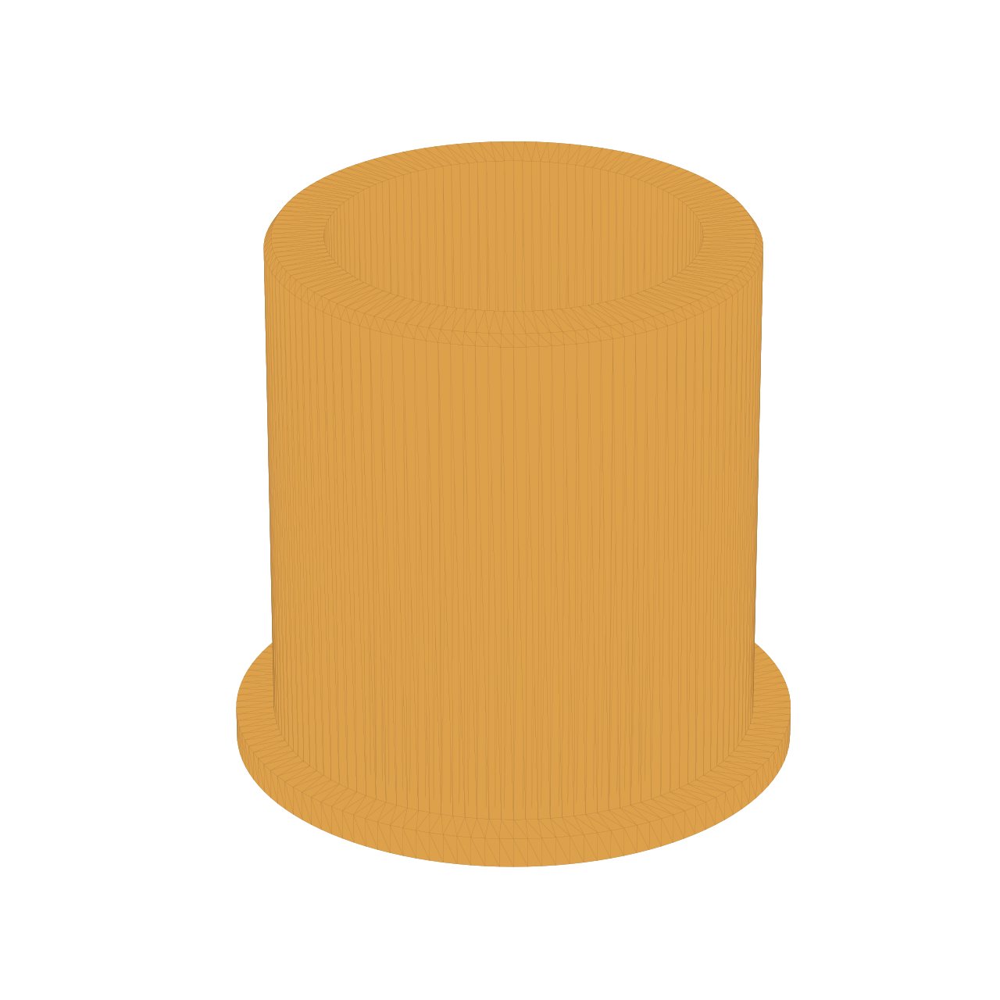

# Rotary Clothesline Reducing Ring – Dimensions

| Feature | Dimension | Source | Confidence |
| --- | ---: | --- | --- |
| Sleeve, inner diameter | 67,00 mm | newly user-confirmed measurement, 2026-09-27 (replaces 60,00 mm) | High |
| Rotary clothesline pole, outer diameter | 50,20 mm | user-confirmed measurement, 2026-09-27 (replaces 43/43,04 mm) | High |
| Insertion depth | 50,00 mm | user statement | High |
| Collar, radial overhang beyond sleeve opening | 5,00 mm per side | design choice: retain the previous 70-mm collar's overhang beyond the then-assumed 60-mm opening | Medium |
| Collar, outer diameter | 77,00 mm | derived: 67,00 + 2 × 5,00 mm; prevents slipping through the sleeve opening | High |
| Collar height | 3,00 mm | unchanged previous user decision | High |
| Overall height | 53,00 mm | derived: 50,00 + 3,00 mm | High |
| Fit | 0,40 mm diametral clearance at both contact surfaces | design choice: ASA sliding fit based on printer profile | Medium |
| Ring outer diameter | 66,60 mm | derived: 67,00 − 0,40 mm | High |
| Ring inner diameter | 50,60 mm | derived: 50,20 + 0,40 mm | High |
| Radial wall thickness | 8,00 mm | derived: (66,60 − 50,60) / 2 mm | High |
| Outer lead-in chamfer | 1,00 mm at sleeve-side end | design choice, not fit-critical | Medium |
| Inner lead-in fillet | Radius 1,00 mm on pole-side collar face | user request, red-marked edge in reference image | High |

## Findings from the First Print

The newly confirmed dimensions from 2026-09-27 replace the previous 60-mm sleeve
assumption: **50,20 mm pole outer diameter** and **67,00 mm sleeve inner
diameter**. The previous value of 60,00 mm is no longer valid for this part.
Older values (43,00/43,04 mm pole, 53,00/60,48 mm sleeve) came from photo
readings and are also invalid.

Tiles 02 and 03 show the failed black print. The read dimensions of 35,85 mm and
52,11 mm are not used as part dimensions. Slicer scaling must be set to 100 %
for the reprint.

## Installation Orientation

The collar (77 mm outer diameter, 3 mm high) rests on the top edge of the 67-mm
sleeve with a 5 mm radial overhang, preventing the ring from slipping inside.
The 50-mm cylinder points into the sleeve; the 50,20-mm pole is inserted from
the collar side through the internal lead-in fillet (R1).

## Printing Instructions

Material: ASA. The ring is a load-bearing functional part, single-color, and
generated as an ASCII STL. Print on one end face, with at least five perimeters
and **50 % infill in the slicer; do not print solid at 100 %.** A rectilinear or
gyroid infill pattern is recommended. Orient the collar on the build plate.
After printing, turn the part over: insert the long cylinder into the sleeve,
leave the collar on top of the sleeve edge, and insert the pole through the
collar. The geometry has no overhangs requiring support.

Before printing the complete part again, an 8-10 mm high fit-test coupon with
the same inner and outer diameters is recommended. If rust, a seam, or ovality
makes the sleeve locally narrower, the diametral clearance can then be increased
parametrically.

## Generation and Validation

`.\.venv\Scripts\python.exe scripts\waeschespinne_reduzierring.py` generates
`models/waeschespinne-reduzierring-67-50.2.stl` as an ASCII STL. Validation with
`.\.venv\Scripts\python.exe scripts\mesh_tool.py validate models\waeschespinne-reduzierring-67-50.2.stl`
reports PASS: 4.608 facets, watertight/manifold, consistent winding,
Euler number 0, and no degenerate triangles; bounding dimensions 77 × 77 × 53 mm.
`.\.venv\Scripts\python.exe scripts\mesh_tool.py overhang models\waeschespinne-reduzierring-67-50.2.stl`
reports 126,68 mm² of overhang area (0,5 %), with no ceilings/bridges. The
small overhang area of the lead-in fillet at the build plate is printable
without supports; a fit-test print is still needed because of ASA shrinkage and
possible sleeve ovality.
